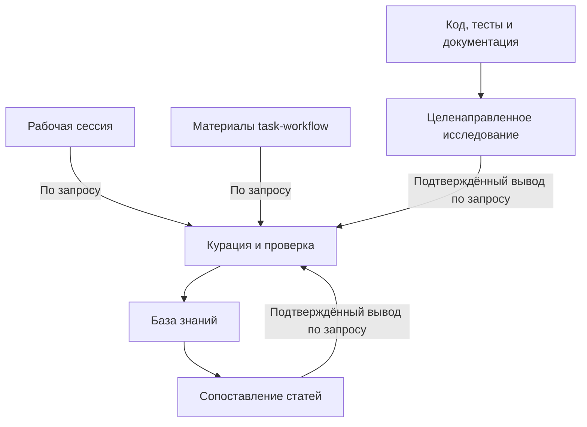

# База проектных знаний в Pi

В ходе обычной задачи мы выясняем, почему сервис ведёт себя определённым образом, где
действует его гарантия и какие ограничения повлияли на решение. Через месяц тот же вопрос
может возникнуть в другой задаче. [База знаний](knowledge_db/index.md) помогает начать
с уже проверенного ответа и сразу найти первоисточник.

## Откуда берутся знания

Основные источники — рабочие сессии, исходный код и материалы [`task-workflow`](extensions/task-workflow/README.md).
В сессии нужный вывод часто уже есть в обсуждении. Когда вопрос ещё открыт, его можно
исследовать по коду, тестам и документации с помощью `knowledge-discovery`.

У задачи, которая прошла через `task-workflow`, есть готовая точка входа. В `context.md`
собраны ограничения, принятые решения и ссылки на тематические заметки. Если в ходе реализации
или проверки появились выводы для следующих этапов, они могут быть в `step-result-N.md`.
Для курации достаточно указать задачу и путь к её `context.md`. Агент отберёт полезное
за пределами задачи и проверит выводы по первоисточникам.



## Как выбрать скил

| Скил                                                           | Когда нужен                                         | Что получите                                           |
| -------------------------------------------------------------- | --------------------------------------------------- | ------------------------------------------------------ |
| [`knowledge-discovery`](skills/knowledge-discovery/SKILL.md)   | Есть конкретный вопрос о проекте или сервисе        | Ответ со ссылками на первоисточники                    |
| [`knowledge-reflection`](skills/knowledge-reflection/SKILL.md) | Есть раздел базы, статьи которого стоит сопоставить | Обоснованный вывод или конкретный открытый вопрос      |
| [`knowledge-curation`](skills/knowledge-curation/SKILL.md)     | Есть материал, из которого стоит сохранить выводы   | Правки в базе, отчёт и предложения, требующие согласия |

`Discovery` и `reflection` возвращают результат в чат. Курацию можно попросить напрямую,
как только известно, из какой сессии или задачи стоит сохранить выводы. Проходить все три
скила по очереди не требуется. Курация встраивает подтверждённое знание в подходящую статью.
Изменение смысла существующего утверждения или его удаление требует явного согласия.
[Правила базы](knowledge_db/AGENTS.md)

В Pi можно описать задачу обычным сообщением или указать скил явно через `/skill:имя-скила`.
[Документация Pi](https://github.com/earendil-works/pi/blob/main/packages/coding-agent/docs/skills.md#understand-how-skills-load)

```text
/skill:knowledge-discovery Как сервис обрабатывает повторные запросы после сбоя?
/skill:knowledge-reflection Сопоставь статьи раздела <раздел базы знаний> и найди общий инвариант.
/skill:knowledge-curation Сохрани проверенные выводы из этой сессии в базе проекта.
```

### Собрать контекст задачи и обновить базу знаний

Подставьте номер задачи или путь к её каталогу.

```text
Просмотри все доступные материалы задачи <номер или путь>, включая её сессии
и Markdown-файлы, на которые нет ссылок из context.md. Обнови базу знаний проекта
проверенными выводами, полезными для других задач.
```
