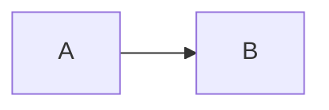

# render-mermaid

The `render-mermaid` Pi extension adds `/render` for opening an assistant's Mermaid diagram as a standalone SVG. It searches Mermaid fenced code blocks in assistant messages on the **active branch of the current session**; it does not search other sessions or inactive branches.

## Install

Place this directory at the global extension location:

```text
~/.pi/agent/extensions/render-mermaid/
```

It must contain `index.ts` (and this README). Start or restart Pi to load the extension. If Pi is already running, use your setup's extension-reload workflow if available; otherwise restart Pi.

### Prerequisite: Mermaid CLI

Install the Mermaid CLI so that `mmdc` is available on Pi's `PATH`. The CLI converts Mermaid source into SVG, which this extension then opens with your system's default SVG application. Follow the [official Mermaid CLI installation instructions](https://github.com/mermaid-js/mermaid-cli); the extension does not install it automatically.

`mmdc --version` checks that the CLI is callable, but does not verify that its Chrome/Chromium browser can launch. A compatible browser must also be installed and available/configured for `mmdc` when it renders.

## Usage

Use `/render` in a session containing Mermaid diagrams in assistant messages:

```text
/render                 # render the latest diagram on the active branch
/render 2               # render diagram number 2
/render order-flow      # render the diagram labeled "order-flow"
```

Numbers are assigned in chronological order to Mermaid blocks on the active branch, including unlabeled blocks. Add an optional label as the first line inside a Mermaid block:

````markdown

````

A unique label can be selected directly. If a label is repeated, its occurrences receive virtual aliases in chronological order, such as `order-flow-1` and `order-flow-2`; use one of those aliases to select an occurrence. Using the repeated unsuffixed label reports the available aliases. The aliases do not alter the Mermaid source.

## SVG output

Each render writes a standalone SVG to a new, unique directory under the host's system temporary directory (`/tmp` on macOS/Linux; the system temporary directory on Windows). The filename contains the diagram number and, when present, its label (for example, `2-order-flow.svg`); labels are sanitized for the filename only. The extension opens the full SVG path with the host OS's default application (`open` on macOS, `xdg-open` on Linux, and best-effort handling on Windows). The SVG remains on disk after rendering so you can copy it. If the opener fails, the command reports the path for manual access.

## Troubleshooting

- **`mmdc` is unavailable:** Install the Mermaid CLI using the [official instructions](https://github.com/mermaid-js/mermaid-cli), ensure `mmdc` is on the `PATH` inherited by Pi, then restart/reload Pi as needed.
- **Chrome/Chromium cannot launch:** A successful `mmdc --version` does not test the browser. Install a compatible Chrome/Chromium or configure Puppeteer/mmdc to use the browser on your system, then retry. The render error includes the relevant `mmdc` diagnostics. The extension does not perform a separate browser test.
- **The system opener is unavailable or fails:** The generated SVG is retained. Use the reported full path to open or copy it manually, and check that your OS has a default application associated with SVG files. Windows opener support is best-effort.
- **No diagram or selector match:** Ensure the diagram is in a Mermaid fenced block in an assistant message on the current active branch. Check its chronological number or the exact label/virtual alias.
