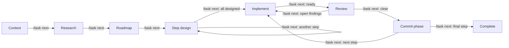

# Task workflow

A [Pi](https://pi.dev/) extension for LLM-assisted coding tasks with phase-specific context and tool permissions. It guides tasks through research, planning, implementation, and review, using purpose-specific sessions and artifacts to manage context while limiting tool access at each stage.


`/task` guides a coding task through context collection, research, roadmap, step design, implementation, review, and a separate commit phase. Context and research share one saved Pi session. Later phases use separate sessions, with compact task artifacts carrying agreed decisions forward.

## 🔄 Workflow



Context → research changes the rules inside the same conversation. The implementation session is reused after review finds issues. Each review round opens a fresh session. A clear review opens a separate commit phase; the next step cannot start until that phase is explicitly completed. In Git projects, manual mode requires the reviewed files to be committed before `/task next`; `autoCommit: true` commits them automatically. Projects without Git still show the phase but skip the Git action.

## 📦 Installation

Choose one of these ways to install the extension.

### Manual checkout

Check out the repository, then copy the extension directory into Pi's global extensions directory:

```bash
git clone https://github.com/vladimir-popov/pi-task-workflow.git
mkdir -p ~/.pi/agent/extensions/task
cp -R pi-task-workflow/extensions/task/. ~/.pi/agent/extensions/task/
```

Restart Pi after installing or updating the files.

### Install as a Pi package

Install the repository as a Pi package:

```bash
pi install git:github.com/vladimir-popov/pi-task-workflow
```

This installs the package and adds it to `~/.pi/agent/settings.json`. Restart Pi after installing. To update it later, run:

```bash
pi update --extensions
```

Pi discovers the extension and bundled skill from the repository's `extensions/` and `skills/` directories. Do not use both installation methods at once, as that may load the extension twice.

### Optional phase skills

The repository includes the optional `task-review` skill. The extension asks Pi to use it during the review phase when it is installed and available; without it, review still works using the extension's built-in instructions. Configure discovered Pi skills in the `skills` object to supplement research, roadmap, step-design, or review prompts. Skills are optional; a missing skill does not block the workflow, and `null` disables a phase skill. The Pi package installation above discovers the bundled review skill automatically. For a manual installation, first clone the repository as shown above, then copy the skill into Pi's skills directory:

```bash
mkdir -p ~/.pi/agent/skills/task-review
cp -R pi-task-workflow/skills/task-review/. ~/.pi/agent/skills/task-review/
```

## 🚀 Usage

Start Pi in the project directory and enter `/task TASK-100500`. Pi asks whether to create a missing task or continue an existing one. Declining leaves the current session unchanged. `/task` and `/task list` show tasks with a short state description and open the same selector in the terminal UI. Existing IDs also appear in command completion.

The extension shows the current phase in a small header above the editor when a task session opens. Once Pi finishes a response, the second line tells you when `/task next` is useful; a pending proposal may instead need `/task accept`. Pi's built-in footer shows the session name. For step design, implementation, review, and commit, the extension adds a short title from the current numbered roadmap step to that name. These UI labels do not enter the model conversation.

Phase kickoffs are hidden extension messages. They guide Pi and start its work without appearing in the editor's ↑ history. After a session switch, ↑ browses the new session's history; the `/task next` command entered in the previous session may therefore not be the first item.

Describe the task over ordinary messages. Use `/task next` when the current discussion is settled. Use `/task accept` to agree to pending proposals and advance; agreement is implied by the command, with no extra note needed. If Pi proposes a version and asks whether to keep it or add an optional feature, `/task accept` keeps the proposed version. If Pi offers several alternatives without recommending one, choose explicitly, for example `/task accept "I prefer option B"`. If there is no pending proposal, `/task accept` advances exactly like `/task next`. Both commands stop when material questions remain, and `/task next` also stops when a proposal still needs approval. A slash command embedded in ordinary text, such as `I agree. /task next`, does not run.

| Command | Action |
| --- | --- |
| `/task TASK-ID [--dir PATH]` | Create or open a task and switch to its current saved session. |
| `/task` or `/task list` | Select an existing task, or show a list outside the terminal UI. |
| `/task delete [TASK-ID]` | Permanently delete a task after a separate confirmation. Without an ID, choose from a selector in the terminal UI. |
| `/task status` | Show the phase, step, session paths, review status, and settings without adding text to the conversation. |
| `/task resume` | Return to the active task in this project. If multiple tasks are available, choose one in the terminal UI; outside it, use `/task TASK-ID` to select. An interrupted run or pending review resumes automatically; otherwise the saved task session simply opens. |
| `/task show [FILE.md]` | Select an existing Markdown artifact or show the named file without adding it to the conversation. File names have completion. |
| `/task next` | Advance after checking the current discussion. In a fresh implementation session, capture a baseline and begin work. In the commit phase, verify the reviewed files are committed before continuing. |
| `/task accept [NOTE]` | Agree to pending proposals and advance. With no proposal, act like `/task next`. A note is optional. |
| `/task help` | Show a short command summary outside the conversation. |

### Hotkeys

The extension binds **Alt+N** to `/task next`, **Alt+A** to `/task accept`, **Alt+S** to `/task status`, and **Alt+W** to `/task show` by default. They invoke the same commands and checks as the slash forms. Hotkeys work when Pi is idle and the input editor is empty; otherwise the extension shows a reminder and leaves the draft untouched. Run Pi's `/hotkeys` to inspect active bindings. On macOS, your terminal may need Option configured as Meta for Alt shortcuts to work.

`/task show` and Alt+W open a selector containing the existing `.md` files directly in the task artifact directory, including previous review rounds. `/task show roadmap.md` opens one directly; `/task show ` completes existing Markdown file names. Outside the terminal UI, `/task show` lists available files. Diff files are not included in this Markdown viewer.

Set `hotkeys` in `~/.pi/agent/task-workflow.json` to change a binding or give any `/task` command a key. Map a command string without `/task` to a Pi key name; use `null` to disable a default. Commands with arguments work too, for example `"show roadmap.md"` or `"TASK-100500"`. Reload Pi after changing the configuration.

```json
{
  "hotkeys": {
    "next": "alt+n",
    "accept": "alt+a",
    "status": "alt+s",
    "show": "alt+w",
    "list": "alt+l",
    "delete": null
  }
}
```

### Task ID parsing

An ID is required to create or open a particular task; `/task` alone opens the list. An unquoted ID ends at a space; quote an ID with internal spaces: `/task "TASK 100500"` or `/task 'TASK 100500'`. `/task TASK 100500` is invalid. IDs may contain ASCII letters, digits, dots, underscores, hyphens, and internal spaces. They must begin with a letter or digit and have no leading or trailing spaces. Slashes and quote characters are invalid. The unquoted command words `help`, `list`, `delete`, `status`, `log`, `abort`, `next`, `accept`, `show`, `start`, and `resume` are reserved; quote one to use it as an ID. `--dir PATH` after the ID chooses a task artifact directory; quote a path containing spaces.

`/task delete` lists tasks in the current project for selection. `/task delete TASK-100500` selects one directly; quote IDs with spaces as above. Both routes ask you to confirm the ID and full artifact directory before deleting. The command removes that directory, including task artifacts, baselines, and saved Pi sessions; project files outside it remain. If the task is open, Pi first switches to a normal session outside the task directory. Finish or cancel a running Pi response before deleting. Outside the terminal UI, provide an explicit ID because there is no selector.

### Phases and artifacts

| Phase | What happens | Artifact updates |
| --- | --- | --- |
| **Context** | Describe the problem, constraints, and possible approaches over several messages. | Pi keeps `context.md` compact and current after each answer. |
| **Research** | Continue in the same session; inspect code and discuss feasibility, code locations, and unresolved questions. | Agreed findings update `context.md`. Open doubts stay out. |
| **Roadmap** | Discuss a numbered plan. New agreed requirements update context and cause a revised complete roadmap proposal. | `context.md` and a draft `roadmap.md`; `/task next` finalizes the roadmap. Top-level steps must be numbered consecutively from 1; short bold titles and dash explanations are preferred, but ordinary numbered Markdown steps are accepted. |
| **Step design** | Discuss each step's approach and checks. Add or revise roadmap items when agreed. | `context.md`, `roadmap.md`, and `step-N.md` as needed; `/task next` finalizes the current step. |
| **Implementation** | Work on the current step in a normal, saved Pi session. After review, repair open findings in that same session. | Project code may change. `/task next` writes `implementation-N.diff` and opens review. |
| **Review** | Inspect the code with read-only project tools in a fresh session. Discuss and track findings. Each finding includes a short exact excerpt from the diff in both the saved review and Pi's response. | `review-N.md`; older rounds are archived as `review-N-round-M.md`. `/task next` returns open findings to implementation or accepts a clear review. |
| **Commit** | A distinct phase after review acceptance, with its own saved session and visible commit result. With `autoCommit: false`, commit the reviewed files manually; `/task next` verifies they are committed before continuing. With `autoCommit: true`, the extension commits them automatically. | Commit title/body are shown in the commit session; no separate Markdown artifact. |

On accepting a clear review, the extension enters a separate commit phase and opens its own saved session before generating the commit result. With `autoCommit: true`, it commits the reviewed files automatically and shows the result there. Otherwise it proposes a commit title and body; `/task next` remains blocked until the reviewed file contents have been committed. If commit-message generation fails, the task remains in the commit phase and `/task next` retries generation. If the model response is unstructured, manual mode uses a labeled fallback based on the changed file names and implementation summary; auto-commit mode skips the commit and asks for a retry. Once the commit phase ends, the next step's implementation session opens, ready for `/task next` to start editing. After the final step's commit phase, the task is complete. Projects without Git, and steps with no code changes, still pass through the phase but have no commit action.

`/task resume` returns to the active task in the current project, including from a fresh `/new` session. If several active tasks exist, the terminal UI offers a selector; outside it, use `/task TASK-ID` to choose one. An aborted run resumes in its saved session with current phase instructions. A review with no saved `review-N.md` also resumes; `/task next` remains blocked until that artifact is saved. If no run needs resuming, the command simply opens the saved task session. It does not advance the phase or clear pending artifacts.

Artifacts can be updated in any phase when an agreed change requires it. Project code can be edited only after `/task next` starts implementation and captures a baseline. The extension tracks the current phase and all saved session files in `state.json`.

The task instructions tell Pi to converse in your language, including explanations, questions, and review discussion. Only task artifact content uses English prose and headings. Pi translates the agreed meaning into English when it writes or revises `context.md`, `roadmap.md`, `step-N.md`, and `review-N.md`. Exact code, identifiers, paths, and required diff excerpts remain unchanged. Existing non-English prose is rewritten when an artifact is next updated or finalized; loading an old task does not rewrite its files automatically.

### 👀 What each Pi sees

Context and research use the same Pi conversation, so research sees the original task description and the full context discussion. `/task next` changes the phase instructions and allowed tools without switching sessions. A configured research model is selected at this boundary; otherwise the current model continues.

Roadmap, each step design, each step implementation, each review round, and each commit phase have their own saved sessions. They see their own messages, Pi's normal instructions, the phase instruction, and task artifacts they read. They do not inherit the preceding phase's chat transcript. The durable handoff is `context.md`, `roadmap.md`, and `step-N.md`; the commit session keeps the commit result and its phase boundary.

The implementation session stays with its step. Returning from review restores that same conversation, including implementation decisions and tool output, and adds the current `review-N.md` as repair guidance. Review is a separate conversation and sees task artifacts, the implementation diff, and code it reads. Each repeated review is a new conversation, so it checks the repaired code independently. Sessions are saved in `<artifactDir>/sessions/`, next to the task artifacts. Opening an older task without a session map creates a saved session for its current phase; earlier background worker conversations cannot be reconstructed.

## ⚙️ Configuration

The extension reads `~/.pi/agent/task-workflow.json` (or `task-workflow.json` in `PI_CODING_AGENT_DIR`). The file is optional; omitted properties use the defaults below. Here is a complete example with different models for implementation and review:

```json
{
  "artifactDir": "{projectRoot}/.agents/projects/{taskId}",
  "autoCommit": false,
  "phaseModels": {
    "implement": {
      "provider": "openrouter",
      "model": "openai/gpt-6-luna",
      "thinkingLevel": "medium"
    },
    "review": {
      "provider": "openrouter",
      "model": "openai/gpt-6-luna",
      "thinkingLevel": "high"
    }
  },
  "skills": {
    "research": null,
    "roadmap": null,
    "steps": null,
    "review": "task-review"
  },
  "reviewTools": [],
  "allowTreeNavigation": false,
  "snapshotMaxFiles": 4000,
  "snapshotMaxMiB": 100
}
```

The model IDs above are examples. Use a provider and model available in your Pi installation.

| Property | Type and default | Effect |
| --- | --- | --- |
| `artifactDir` | Nonempty path template; `{projectRoot}/.agents/projects/{taskId}` | Directory for all task artifacts and saved sessions. A relative path resolves from the project root. `{projectRoot}` and `{taskId}` are replaced when a task is created. `/task TASK-ID --dir PATH` overrides it for that task. Existing tasks keep the directory recorded in `state.json`. |
| `autoCommit` | Boolean; `false` | After a clear review in a Git project, `false` prepares an English commit title and body; `true` commits the reviewed code files. Automatic commit requires a clean code working tree when implementation starts. With no Git repository, neither mode creates a commit. |
| `phaseModels` | Object; `{}` | Model overrides by phase. Valid keys: `collect`, `research`, `roadmap`, `steps`, `implement`, `review`. Each value is a model object or `null`; omitted keys and `null` leave Pi's current model in place. |
| `skills` | Object; `{ "review": "task-review" }` | Maps phase names to Pi skill names. Valid keys: `research`, `roadmap`, `steps`, `review`. Each value is a skill name or `null`; omitted research/roadmap/steps entries add no skill, and omitted `review` uses `task-review`. A missing skill does not block the phase. `null` disables a phase skill. Use names such as `roadmap-planning`, not paths to `SKILL.md`. |
| `reviewSkill` | Pi skill name or `null`; unset (deprecated) | Legacy alias for `skills.review`. `skills.review` takes precedence when both are set. |
| `reviewTools` | Array of tool names; `[]` | Adds tools to review's default set: `read`, `grep`, `find`, `ls`, and `task_write_artifact`. Add only tools you trust for read-only project work. This setting does not remove default tools. |
| `allowTreeNavigation` | Boolean; `false` | Allows Pi's `/tree` command inside task sessions when `true`. Branches still share the same task state and artifacts. |
| `hotkeys` | Object; `{ "next": "alt+n", "accept": "alt+a", "status": "alt+s", "show": "alt+w" }` | Maps `/task` command text to a key. Set a command to `null` to disable its default; omitted commands keep defaults. Each active key must be unique within this extension. The binding applies when Pi starts or reloads the extension. |
| `snapshotMaxFiles` | Positive integer; `4000` | Maximum number of files included in the baseline before implementation. Without Git this covers all regular project files except the exclusions described below; with Git it covers existing changed files needing a copy. Exceeding the limit stops implementation before copying. |
| `snapshotMaxMiB` | Integer from `1` to `1000000`; `100` | Maximum combined size, in MiB, of files copied into the baseline. Exceeding it stops implementation before copying. |

### Model settings

A model object has this shape:

```json
{
  "provider": "openrouter",
  "model": "openai/gpt-6-luna",
  "thinkingLevel": "medium"
}
```

`provider` and `model` are required nonempty strings and must identify a model Pi can find and authenticate. `thinkingLevel` is optional and accepts `off`, `minimal`, `low`, `medium`, `high`, `xhigh`, or `max`. When omitted, Pi keeps the current thinking level. A missing or `null` override keeps Pi's current model.

Add any phase to `phaseModels` using the same object shape. For example, `phaseModels.research` selects a model when context moves into research, while `phaseModels.review` selects one for each new review session.

The context model is selected when its session opens. Research shares that session, so its model override is applied on the context → research transition. Other overrides apply when their new phase session opens. Reopening a session with an already applied override keeps its saved model; changing configuration does not retroactively replace it. You can also change a session's model with Pi's normal controls.

`context.md`, `roadmap.md`, `step-N.md`, `implementation-N.diff`, `review-N.md`, `state.json`, and `sessions/` live in `artifactDir`. Task discovery scans the default directory, the configured template when possible, and a small index under `~/.pi/agent/task-workflow-index/`.

## 🔧 Implementation notes

`task_write_artifact` replaces a complete task artifact atomically. The model supplies an artifact kind and optional step number, while the extension chooses the path. It refuses to replace a symbolic link. The extension writes task state and implementation diffs itself. The transition check uses the recent phase discussion and current review artifact to identify open questions or unapproved proposals; it is a model judgment, so important decisions should be explicit.

The English-only artifact rule appears in each phase's system instructions, in the artifact tool description, and in the separate model request that finalizes an artifact. It guides generation; the extension does not try to classify the language of code, file names, or quoted diff lines.

For review artifacts, the extension standardizes the first heading to `# Review: step N` and requires `## Summary` and `## Findings`. Each finding needs one exact fenced excerpt from `implementation-N.diff`. A failed validation leaves review pending and reports the specific missing section or invalid excerpt; `/task next` advances only after `review-N.md` is saved.

The review phase also asks Pi to show each finding's severity, location, impact, and the same short fenced `diff` excerpt directly in its answer, so you can discuss the code without opening `review-N.md`. The artifact remains the durable record. The excerpt is limited to the relevant changed lines; the full implementation diff stays in `implementation-N.diff`.

### Safety mechanisms

The `before_agent_start` hook shows only the phase's allowed tools. A `tool_call` hook also blocks calls to other tools. Context, research, roadmap, and step design allow reading project files and writing task artifacts. Implementation permits code editing only after its baseline is captured. Review and commit use read-only tools; commit-phase code must be committed through Git outside the model's tool access. These are Pi tool controls, not operating system file permissions; a user command or another extension's own code can still write files.

### Tree navigation

`/tree` changes the conversation branch but does not roll task artifacts or project code back. The extension blocks it in task sessions by default. Set `allowTreeNavigation: true` to remove this block; all branches still share the latest artifacts and state. `/task status` shows the setting.

### Implementation diff

Before editing begins, the extension captures a baseline. With Git, it copies existing changed files and later combines their before/after patches with Git's diff for newly changed files. Without Git, it snapshots all regular project files below the project root except the task artifact directory, `.git` directories, and symbolic links. It compares changed files using `git diff --no-index`, which requires the Git executable but not a repository. The baseline remains through repair and review rounds, then is removed when the step is accepted.

The defaults limit a snapshot to 4,000 files and 100 MiB. The extension checks those limits before copying and does not start implementation when either is exceeded. `implementation-N.diff` contains the full result; large diffs can still be expensive to review and to use for commit-message generation. This diff mechanism remains separate from the session workflow and can be revised later.
