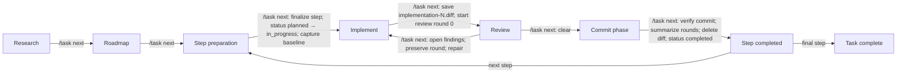

# Task workflow

**Version: 2.0**

A [Pi](https://pi.dev/) extension for LLM-assisted coding tasks with phase-specific context and tool permissions. It guides tasks through research, planning, implementation, and review, using purpose-specific sessions and artifacts to manage context while limiting tool access at each stage.


`/task` guides a coding task through research, roadmap, implementation, review, and a separate commit phase. Research covers task context, discussion, and code investigation in one saved Pi session; later phases use separate sessions, with compact task artifacts carrying agreed decisions forward. Each implementation session starts with final discussion of just its current step before coding begins.

## 🔄 Workflow



Research gathers task context and investigates code in one saved conversation. Each step's preparation discussion and implementation share one saved session; after review finds issues, repairs return to that same session. Each review round opens a fresh session. A clear review opens a separate commit phase; the next step cannot start until that phase is explicitly completed. In Git projects, manual mode requires the reviewed files to be committed before `/task next`; `autoCommit: true` commits them automatically. If Git is not detected, the commit phase remains open and `/task next` retries detection and message generation; create or initialize the repository, then retry. Use `/task skip-commit` only to explicitly skip this phase; the step execution record notes that choice. Projects without Git remain in commit until Git is created or the user explicitly skips.

All task files use a fixed project-local layout:

```text
.agents/task-workflow/
├── config.json                     # Project-level mode and autoCommit overrides
└── <task-id>/
    ├── state.json                  # Workflow state and task-level overrides
    ├── sessions/
    ├── baselines/
    └── context/
        ├── context.md
        ├── roadmap.md
        ├── step-N.md
        ├── review-N-round-M.md
        └── implementation-N.diff   # Temporary; removed when the step completes
```

Task paths are fixed under `.agents/task-workflow/`; project `config.json` lives alongside task directories. The full directory contains local task data; add it to `.gitignore` if desired.

### Optional phase skills

The review procedure and artifact format are defined by the extension. A skill configured in `skills.review` adds user-specific review preferences; it does not replace the workflow's procedure, format, tool boundaries, or artifact path. No review skill is selected by default. Configure one in `skills.review` to add preferences, or set it to `null` to disable it. If the selected skill is unavailable, the built-in review instructions still apply. Other phase skills are optional; a missing skill does not block the workflow.

## 🚀 Usage

Start Pi in the project directory and enter `/task TASK-100500`. Pi asks whether to create a missing task or continue an existing one. Declining leaves the current session unchanged. `/task` and `/task list` show tasks with a short state description and open the same selector in the terminal UI. Existing IDs also appear in command completion. If you rename a project directory, close Pi and start it from the new path. In the terminal UI, `/task` or `/task resume` can show project-local tasks marked as moved and ask for confirmation before relocating their state and saved sessions. Declining leaves the task unchanged. Outside the terminal UI, relocation is refused. Session/state paths are rebased, but historical prose in the conversation or artifacts is not rewritten.

The extension shows the current phase in a small header above the editor when a task session opens. Once Pi finishes a response, the second line tells you when `/task next` is useful; a pending proposal may instead need `/task accept`. The first line colors the task name, current settings, phase, and phase description separately. By default, the task name is bright green, settings are bright black, and the phase and description are blue. Configure these colors with `statusColors` (see Configuration). Pi's built-in footer shows the session name. For implementation preparation, implementation, review, and commit, the extension adds a short title from the current numbered roadmap step to that name. These UI labels do not enter the model conversation.

Phase kickoffs are hidden extension messages. They guide Pi and start its work without appearing in the editor's ↑ history. After a session switch, ↑ browses the new session's history; the `/task next` command entered in the previous session may therefore not be the first item.

Describe the task over ordinary messages. Use `/task next` when the current discussion is settled. Use `/task accept` to agree to pending proposals and advance; agreement is implied by the command, with no extra note needed. If Pi proposes a version and asks whether to keep it or add an optional feature, `/task accept` keeps the proposed version. If Pi offers several alternatives without recommending one, choose explicitly, for example `/task accept "I prefer option B"`. If there is no pending proposal, `/task accept` advances exactly like `/task next`. Both commands stop when material questions remain, and `/task next` also stops when a proposal still needs approval. A slash command embedded in ordinary text, such as `I agree. /task next`, does not run.

| Command                     | Action                                                                                                                                                                                                                                                           |
| --------------------------- | ---------------------------------------------------------------------------------------------------------------------------------------------------------------------------------------------------------------------------------------------------------------- |
| `/task TASK-ID`             | Create or open a task and switch to its current saved session.                                                                                                                                                                                                   |
| `/task` or `/task list`     | Select an existing task, or show a list outside the terminal UI.                                                                                                                                                                                                 |
| `/task delete [TASK-ID]`    | Permanently delete a task after a separate confirmation. Without an ID, choose from a selector in the terminal UI.                                                                                                                                               |
| `/task status`              | Show the phase, step, session paths, review status, and settings without adding text to the conversation.                                                                                                                                                        |
| `/task config`              | Show the full effective configuration for the active task, including inherited settings and defaults.                                                                                                                                                            |
| `/task config init project` | Create `.agents/task-workflow/config.json` with the current project/global `mode` and `autoCommit`; refuses to overwrite an existing file.                                                                                                                       |
| `/task config init task`    | Materialize the current effective `mode` and `autoCommit` as overrides in the active task's `state.json`.                                                                                                                                                        |
| `/task resume`              | Return to the active task in this project. If multiple tasks are available, choose one in the terminal UI; outside it, use `/task TASK-ID` to select. An interrupted run or pending review resumes automatically; otherwise the saved task session simply opens. |
| `/task show [FILE.md]`      | Select an existing Markdown artifact or show the named file without adding it to the conversation. File names have completion.                                                                                                                                   |
| `/task next`                | Advance after checking the current discussion. In implementation preparation, finalize the current step design, capture a baseline, and begin work. In the commit phase, verify the reviewed files are committed before continuing.                              |
| `/task accept [NOTE]`       | Agree to pending proposals and advance. With no proposal, act like `/task next`. A note is optional.                                                                                                                                                             |
| `/task skip-commit`         | Explicitly skip the current commit phase and continue the task. Available only during commit; records the intentional skip in the step execution record.                                                                                                         |
| `/task help`                | Show a short command summary outside the conversation.                                                                                                                                                                                                           |

### Hotkeys

The extension binds **Alt+N** to `/task next`, **Alt+A** to `/task accept`, **Alt+S** to `/task status`, and **Alt+W** to `/task show` by default. They invoke the same commands and checks as the slash forms. Hotkeys work when Pi is idle and the input editor is empty; otherwise the extension shows a reminder and leaves the draft untouched. Run Pi's `/hotkeys` to inspect active bindings. On macOS, your terminal may need Option configured as Meta for Alt shortcuts to work.

`/task show` and Alt+W open a selector containing the existing `.md` files directly in the task artifact directory, including previous review rounds. `/task show roadmap.md` opens one directly; `/task show ` completes existing Markdown file names. Outside the terminal UI, `/task show` lists available files. Diff files are not included in this Markdown viewer.

Set `hotkeys` in `~/.pi/agent/task-workflow.json` to change a binding or give any `/task` command a key. Map a command string without `/task` to a Pi key name; use `null` to disable a default. Commands with arguments work too, for example `"show roadmap.md"` or `"TASK-100500"`. Reload Pi after changing the configuration.

```json
{
  "hotkeys": {
    "next": "alt+n",
    "accept": "alt+a",
    "status": "alt+s",
    "show": "alt+w",
    "list": "alt+l",
    "delete": null
  }
}
```

### Task ID parsing

An ID is required to create or open a particular task; `/task` alone opens the list. An unquoted ID ends at a space; quote an ID with internal spaces: `/task "TASK 100500"` or `/task 'TASK 100500'`. `/task TASK 100500` is invalid. IDs may contain ASCII letters, digits, dots, underscores, hyphens, and internal spaces. They must begin with a letter or digit and have no leading or trailing spaces. Slashes and quote characters are invalid. The unquoted command words `help`, `list`, `delete`, `status`, `log`, `abort`, `next`, `accept`, `show`, `start`, `config`, and `resume` are reserved; quote one to use it as an ID. Task storage paths are fixed.

`/task delete` lists tasks in the current project for selection. `/task delete TASK-100500` selects one directly; quote IDs with spaces as above. Both routes ask you to confirm the artifact and runtime directories before deleting. The command removes both directories, including task artifacts, local state, baselines, and saved Pi sessions; project files outside them remain. If the task is open, Pi first switches to a normal session outside the task directory. Finish or cancel a running Pi response before deleting. Outside the terminal UI, provide an explicit ID because there is no selector.

### Phases and artifacts

| Phase              | What happens                                                                                                                                                                                                                                                                                                                                                                                                                | Artifact updates                                                                                                                                                                                                                            |
| ------------------ | --------------------------------------------------------------------------------------------------------------------------------------------------------------------------------------------------------------------------------------------------------------------------------------------------------------------------------------------------------------------------------------------------------------------------- | ------------------------------------------------------------------------------------------------------------------------------------------------------------------------------------------------------------------------------------------- |
| **Research**       | Describe the problem, constraints, and possible approaches; inspect project files and use available read-only web search/fetch tools (or `tool_search` to discover them) to discuss feasibility, code locations, and unresolved questions. Project files cannot be edited in this phase.                                                                                                                                    | Pi keeps `context.md` compact and current; `task_write_artifact` may write only `context.md` in Research.                                                                                                                                   |
| **Roadmap**        | Discuss a numbered plan. New agreed requirements update context and cause a revised complete roadmap proposal.                                                                                                                                                                                                                                                                                                              | `context.md` and a draft `roadmap.md`; `/task next` finalizes the roadmap. Top-level steps must be numbered consecutively from 1; short bold titles and dash explanations are preferred, but ordinary numbered Markdown steps are accepted. |
| **Implementation** | Each step opens in a saved preparation session. Pi starts by summarizing the roadmap item and stating that this is the final discussion before coding. Discuss only the current step and its checks. `/task next` checks for open questions/proposals, finalizes `step-N.md`, marks it `in_progress`, captures a local baseline, and starts coding in the same session. After review, repair open findings in that session. | Only the current step needs a `step-N.md`; future step designs are deferred. `/task next` after implementation writes the temporary `implementation-N.diff` and opens review.                                                               |
| **Review**         | Each round uses a fresh read-only session. The first report is `review-N-round-0.md`; every subsequent round gets the next number and all reports are retained.                                                                                                                                                                                                                                                             | `/task next` returns open findings to implementation or accepts a clear review.                                                                                                                                                             |
| **Commit**         | A distinct phase after review acceptance. After the commit is verified, the extension records review outcomes in `step-N.md`, marks it `completed`, and removes `implementation-N.diff`.                                                                                                                                                                                                                                    | Round reports remain available as the review history.                                                                                                                                                                                       |
| **Commit**         | A distinct phase after review acceptance, with its own saved session and visible commit result. With `autoCommit: false`, commit the reviewed files manually; `/task next` verifies they are committed before continuing. With `autoCommit: true`, the extension commits them automatically.                                                                                                                                | Commit title/body are shown in the commit session; no separate Markdown artifact.                                                                                                                                                           |

On accepting a clear review, the extension enters a separate commit phase and opens its own saved session before generating the commit result. With `autoCommit: true`, it commits the reviewed files automatically and shows the result there. Otherwise it proposes a commit title and body; `/task next` remains blocked until the reviewed file contents have been committed. If Git is not detected, the phase remains open and `/task next` retries detection and message generation; create or initialize the repository, then retry. Use `/task skip-commit` only to explicitly skip this phase; the step execution record notes that choice. If commit-message generation fails, the task remains in the commit phase and `/task next` retries generation. If the model response is unstructured, manual mode uses a labeled fallback based on the changed file names and implementation summary; auto-commit mode skips the commit and asks for a retry. Once the commit phase ends, the next step's preparation session opens with a short summary of its roadmap scope. After the final step's commit phase, the task is complete. Steps with no code changes still pass through without a commit action.

`/task resume` returns to the active task in the current project, including from a fresh `/new` session. If several active tasks exist, the terminal UI offers a selector; outside it, use `/task TASK-ID` to choose one. It also detects confirmed project-directory renames for project-local tasks. An aborted run resumes in its saved session with current phase instructions. A review with no saved `review-N-round-M.md` for the active round also resumes; `/task next` remains blocked until that artifact is saved. If no run needs resuming, the command simply opens the saved task session. It does not advance the phase or clear pending artifacts.

Artifacts can be updated in any phase when an agreed change requires it. Project code can be edited only after `/task next` starts implementation and captures a baseline. The extension tracks the current phase and all saved session files in `state.json`.

The task instructions tell Pi to converse in your language, including explanations, questions, and review discussion. Only task artifact content uses English prose and headings. Pi translates the agreed meaning into English when it writes or revises `context.md`, `roadmap.md`, `step-N.md`, and `review-N-round-M.md`. Exact code, identifiers, paths, and required diff excerpts remain unchanged. Existing non-English prose is rewritten when an artifact is next updated or finalized; loading an old task does not rewrite its files automatically.

### 👀 What each Pi sees

Research gathers task context and investigates the code in the same Pi conversation. The configured research model is selected when the task starts; otherwise the current model continues. `/task next` advances to the roadmap and changes the phase instructions and allowed tools without switching sessions.

Roadmap, each step's implementation session, each review round, and each commit phase have their own saved sessions. A new implementation session starts with a preparation discussion and a short summary of the current roadmap item; the same session continues into coding after `/task next` captures the baseline. It does not inherit the roadmap chat transcript. The durable handoff is `context.md`, `roadmap.md`, and the current `step-N.md`; the commit session keeps the commit result and its phase boundary.

Returning from review restores that step's implementation session, including preparation decisions, implementation messages, and tool output, and adds the current `review-N-round-M.md` as repair guidance. Review is a separate conversation and sees task artifacts, the current implementation diff, and code it reads. Each repeated review is a new conversation, so it checks the repaired code independently. Sessions and baselines are saved under the task directory, separate from its `context/` artifacts. Opening an older task without a session map creates a saved session for its current phase; earlier background worker conversations cannot be reconstructed.

## ⚙️ Configuration

The extension reads `~/.pi/agent/task-workflow.json` (or `task-workflow.json` in `PI_CODING_AGENT_DIR`). Project overrides live in `<projectRoot>/.agents/task-workflow/config.json`; task overrides live in that task's `state.json`. Settings resolve in task → project → global → built-in-default order. For `skills`, `phaseModels`, `hotkeys`, and `statusColors`, entries resolve by key; other values, including arrays, are replaced by the most local setting. Missing keys inherit; `null` explicitly disables skills and phase models, and can disable default hotkeys. The global file is optional; omitted properties use the defaults below. Run `/task config init project` to create project settings from current values (it refuses to overwrite an existing file), or `/task config init task` to materialize current effective values as task overrides. Edit the resulting JSON or `state.json` to change values. Here is a complete example with different models for implementation and review:

```json
{
  "mode": "manual",
  "autoCommit": false,
  "statusColors": {
    "taskName": "brightGreen",
    "currentSettings": "brightBlack",
    "currentPhase": "blue",
    "phaseDescription": "blue"
  },
  "phaseModels": {
    "implement": {
      "provider": "openrouter",
      "model": "openai/gpt-6-luna",
      "thinkingLevel": "medium"
    },
    "review": {
      "provider": "openrouter",
      "model": "openai/gpt-6-luna",
      "thinkingLevel": "high"
    }
  },
  "skills": {
    "research": null,
    "roadmap": null,
    "implement": null,
    "review": null,
    "commit": null
  },
  "reviewTools": [],
  "allowTreeNavigation": false,
  "snapshotMaxFiles": 4000,
  "snapshotMaxMiB": 100
}
```

The model IDs above are examples. Use a provider and model available in your Pi installation.

| Property              | Type and default                                                                     | Effect                                                                                                                                                                                                                                                                                                                                                                                                                                                                                                                                   |
| --------------------- | ------------------------------------------------------------------------------------ | ---------------------------------------------------------------------------------------------------------------------------------------------------------------------------------------------------------------------------------------------------------------------------------------------------------------------------------------------------------------------------------------------------------------------------------------------------------------------------------------------------------------------------------------- |
| `mode`                | `manual` or `semi-auto`; `manual`                                                    | Workflow transition policy. `manual` requires `/task next` or `/task accept`. In `semi-auto`, when an agent turn settles, implementation advances to review and a saved review advances to repair or acceptance if the transition check finds no open questions or unapproved proposals. It pauses on uncertainty. A manual commit still requires `/task next`; with `autoCommit: true`, a successful automatic commit advances to the next step. Configure globally, per project, or per task; more local values override broader ones. |
| `autoCommit`          | Boolean; `false`                                                                     | After a clear review in a Git project, `false` prepares an English commit title and body; `true` commits the reviewed code files. Automatic commit requires a clean code working tree when implementation starts. With no Git repository, neither mode creates a commit. It can be overridden per project and task.                                                                                                                                                                                                                      |
| `statusColors`        | Object; bright green, bright black, blue, blue                                       | Colors for `taskName`, `currentSettings`, `currentPhase`, and `phaseDescription`, respectively. Each value accepts an ANSI color name (`black`, `red`, `green`, `yellow`, `blue`, `purple`, `cyan`, `white`, or a `bright`-prefixed variant), a 0–255 palette index, or a hex color such as `#RRGGBB`. Unspecified values use their defaults.                                                                                                                                                                                            |
| `phaseModels`         | Object; `{}`                                                                         | Model overrides by phase. Valid keys: `research`, `roadmap`, `implement`, `review`. New tasks use `phaseModels.implement` throughout step preparation and coding. Each value is a model object or `null`; omitted keys and `null` leave Pi's current model in place.                                                                                                                                                                                                                                                                     |
| `skills`              | Object; `{}`                                                                         | Maps phase names to Pi skill names. Valid keys: `research`, `roadmap`, `implement`, `review`, `commit`. Each value is a skill name or `null`; omitted entries inherit from the broader scope, while `null` explicitly disables the skill. A review skill adds user-specific preferences but does not replace the built-in review procedure. A missing skill does not block the phase. Use names such as `roadmap-planning`, not paths to `SKILL.md`.                                                                                     |
| `reviewTools`         | Array of tool names; `[]`                                                            | Replaces the additional review tool list from broader scopes. These tools are added to review's built-in set: `read`, `grep`, `find`, `ls`, and `task_write_artifact`. Add only tools you trust for read-only project work.                                                                                                                                                                                                                                                                                                              |
| `allowTreeNavigation` | Boolean; `false`                                                                     | Allows Pi's `/tree` command inside task sessions when `true`. Branches still share the same task state and artifacts.                                                                                                                                                                                                                                                                                                                                                                                                                    |
| `hotkeys`             | Object; `{ "next": "alt+n", "accept": "alt+a", "status": "alt+s", "show": "alt+w" }` | Maps `/task` command text to a key. Set a command to `null` to disable its default; omitted commands keep defaults. Each active key must be unique within this extension. Hotkey registrations are global and apply when Pi starts or reloads the extension; project/task-specific hotkeys are not supported.                                                                                                                                                                                                                                                                                                   |
| `snapshotMaxFiles`    | Positive integer; `4000`                                                             | Maximum number of files included in the baseline before implementation. Without Git this covers all regular project files except the exclusions described below; with Git it covers existing changed files needing a copy. Exceeding the limit stops implementation before copying.                                                                                                                                                                                                                                                      |
| `snapshotMaxMiB`      | Integer from `1` to `1000000`; `100`                                                 | Maximum combined size, in MiB, of files copied into the baseline. Exceeding it stops implementation before copying.                                                                                                                                                                                                                                                                                                                                                                                                                      |

### Model settings

A model object has this shape:

```json
{
  "provider": "openrouter",
  "model": "openai/gpt-6-luna",
  "thinkingLevel": "medium"
}
```

`provider` and `model` are required nonempty strings and must identify a model Pi can find and authenticate. `thinkingLevel` is optional and accepts `off`, `minimal`, `low`, `medium`, `high`, `xhigh`, or `max`. When omitted, Pi keeps the current thinking level. A missing or `null` override keeps Pi's current model.

Add any supported phase to `phaseModels` using the same object shape. For example, `phaseModels.research` selects a model when the task starts, while `phaseModels.review` selects one for each new review session.

The research model is selected when its session opens. Other overrides apply when their new phase session opens. Reopening a session with an already applied override keeps its saved model; changing configuration does not retroactively replace it. You can also change a session's model with Pi's normal controls.

Task artifacts live in `.agents/task-workflow/<task-id>/context/`; `implementation-N.diff` exists only while the step is active. `state.json`, `sessions/`, and `baselines/` live directly under `.agents/task-workflow/<task-id>/`. Task discovery scans these fixed task directories and a small index under `~/.pi/agent/task-workflow-index/`.

## 🔧 Implementation notes

`task_write_artifact` replaces a complete task artifact atomically. The model supplies an artifact kind and optional step number, while the extension chooses the path. It refuses to replace a symbolic link. The extension writes task state and implementation diffs itself. The transition check uses the recent phase discussion and current review artifact to identify open questions or unapproved proposals; it is a model judgment, so important decisions should be explicit.

The English-only artifact rule appears in each phase's system instructions, in the artifact tool description, and in the separate model request that finalizes an artifact. It guides generation; the extension does not try to classify the language of code, file names, or quoted diff lines.

The extension's review prompt defines the review procedure and artifact format. A configured review skill contributes only user-specific preferences; no review skill is selected by default. The extension does not validate or normalize review artifact formatting; it only requires the review artifact to be saved before the phase can advance. Review status summaries recognize Markdown `###` finding headings and `Status: resolved` or `Status: dismissed` markers when present.

### Safety mechanisms

The `before_agent_start` hook shows only the phase's allowed tools. A `tool_call` hook also blocks calls to other tools. Research, roadmap, and implementation preparation allow reading project files and writing task artifacts. Implementation permits code editing only after its baseline is captured. Review and commit use read-only tools; commit-phase code must be committed through Git outside the model's tool access. These are Pi tool controls, not operating system file permissions; a user command or another extension's own code can still write files.

### Tree navigation

`/tree` changes the conversation branch but does not roll task artifacts or project code back. The extension blocks it in task sessions by default. Set `allowTreeNavigation: true` to remove this block; all branches still share the latest artifacts and state. `/task status` shows the setting.

### Implementation diff

Before editing begins, the extension captures a baseline under the task directory. With Git, it copies existing changed files and later combines their before/after patches with Git's diff for newly changed files. Without Git, it snapshots all regular project files below the project root except the task directory, `.git` directories, and symbolic links. It compares changed files using `git diff --no-index`, which requires the Git executable but not a repository. The baseline remains through repair and review rounds, then is removed when the commit phase is prepared.

The defaults limit a snapshot to 4,000 files and 100 MiB. The extension checks those limits before copying and does not start implementation when either is exceeded. `implementation-N.diff` contains the full result with paths relative to the project root; large diffs can still be expensive to review and to use for commit-message generation. It is removed after the step's commit phase completes.

Each `step-N.md` includes a workflow status: `planned` after its design is finalized, `in_progress` from implementation through review and commit, and `completed` only after the commit phase finishes. At completion, the extension adds a compact execution record with review-round summaries, accepted decisions, and finding dispositions. The complete round reports remain separately available.
