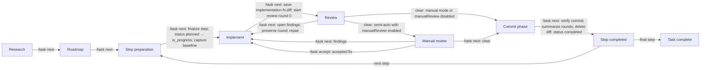

# Task workflow

**Version: 2.9.0**

A [Pi](https://pi.dev/) extension for LLM-assisted coding tasks with phase-specific context and tool permissions. It guides tasks through research, planning, implementation, and review, using purpose-specific sessions and artifacts to manage context while limiting tool access at each stage.

## Changelog

### 2.9.0

- Added `/task browse` and `/task delete --global [TASK-ID]` to find and delete tasks
  across indexed project roots; the browser can also remove broken index entries.
- Added discovery and deletion support for historical tasks under
  `.agents/projects/<task-id>/`.
- Added configurable deletion modes: move task data to the OS trash by default or
  permanently delete it. If moving to trash fails, the extension can ask to retry
  the remaining paths with permanent deletion.
- Hardened task discovery and deletion with path and index validation; unrecognized or
  unsafe task data is preserved, and deletion confirmations identify the selected paths.


`/task` guides a coding task through research, roadmap, implementation, review, and commit.
By default, semi-auto mode pauses for manual review between automated review and commit.
Research covers task context, discussion, and code investigation in one saved Pi session;
later phases use separate sessions, with compact task artifacts carrying agreed decisions
forward. Each implementation session starts with final discussion of just its current step
before coding begins.

## 🔄 Workflow



Research gathers task context and investigates code in one saved conversation. Each step's
preparation discussion and implementation share one saved session; after review finds
issues, repairs return to that same session. Each review round opens a fresh session. A
clear review opens a separate commit phase. In semi-auto mode with `manualReview` enabled,
it opens a separate manual-review phase first. The next step cannot start until commit is completed.
In Git projects, manual mode requires the reviewed files to be committed before
`/task next`; `autoCommit: true` commits them automatically. If Git is not
detected, the commit phase remains open. `/task next` retries Git detection and
commit-message generation; `/task accept` skips this commit and continues, recording the
intentional skip in the step execution record. Projects without Git remain in commit until
Git is created or the user accepts the skip.

New tasks use this project-local layout:

```text
.agents/task-workflow/
├── config.json                     # Optional project settings
└── <task-id>/
    ├── config.json                 # Optional task settings
    ├── state.json                  # Workflow state
    ├── sessions/
    ├── baselines/
    └── context/
        ├── context.md
        ├── roadmap.md
        ├── step-N.md                # Retains compact review execution summaries
        ├── review-N-round-M.md      # Temporary; removed when the step completes
        └── implementation-N.diff   # Temporary; removed when the step completes
```

The extension also recognizes historical tasks stored under
`.agents/projects/<task-id>/`. Project settings remain in `.agents/task-workflow/config.json`.
The full task directories contain local data; add them to `.gitignore` if desired.

### Optional phase skills

The extension owns the review contract: the approved scope is reviewed read-only, the workflow
cannot advance, and the coordinator saves exactly one final artifact at the extension-selected
path using `task_write_artifact`. The existing report structure and single-agent procedure are
the defaults. An available skill configured in `skills.review` may define the review procedure,
including delegating checks to subagents and consolidating their findings, but cannot override
that contract or allow subagents to write the artifact. Tools needed by a procedure must be
explicitly enabled with `reviewTools`; this does not grant them in other phases. If the skill is
missing or unavailable, the built-in procedure applies.

The commit session may use `skills.commit`. The separate commit-message generation request
does not receive the skill contents. Its built-in prompt provides the commit-message rules
regardless of configuration, and references the configured commit skill by name when one is
set. A missing skill does not block the workflow.

## 🚀 Usage

Start Pi in the project directory and enter `/task TASK-100500`. Pi asks whether to create a missing
task or continue an existing one. Declining leaves the current session unchanged. `/task` and
`/task list` show project-local tasks with a short state description and their last worked time,
based on the newest saved task session. Both open the same selector in the terminal UI. Use
`/task browse` to inspect tasks across indexed projects and recognized layouts; in the terminal
UI, this selector is for deletion only. Existing project-local IDs also appear in command
completion.

If you rename a project directory, close Pi and start it from the new path. In the terminal UI,
`/task` or `/task resume` can show project-local tasks marked as moved and ask for confirmation
before relocating their state and saved sessions. Declining leaves the task unchanged. Outside
the terminal UI, relocation is refused. Session/state paths are rebased, but historical prose in
the conversation or artifacts is not rewritten.

The extension shows the current phase in a small header above the editor when a task session opens. Once Pi finishes a response, the second line tells you when `/task next` is useful; a pending proposal may instead need `/task accept`. The first line colors the task name, current settings (mode, auto-commit, manual review, and extension version), phase, and phase description separately. By default, the task name is bright green, settings are bright black, and the phase and description are blue. When the project is not inside a Git repository, the widget adds a red `⚠ No Git repository` warning. Configure the other colors with `statusColors` (see Configuration). Pi's built-in footer shows the session name. For implementation preparation, implementation, review, manual review, and commit, the extension adds a short title from the current numbered roadmap step to that name. These UI labels do not enter the model conversation.

Phase kickoffs are hidden extension messages. They guide Pi and start its work without appearing in the editor's ↑ history. After a session switch, ↑ browses the new session's history; the `/task next` command entered in the previous session may therefore not be the first item.

Describe the task over ordinary messages. Use `/task next` when the current discussion is settled. Use `/task accept` to agree to pending proposals and advance; agreement is implied by the command, with no extra note needed. If Pi proposes a version and asks whether to keep it or add an optional feature, `/task accept` keeps the proposed version. If Pi offers several alternatives without recommending one, choose explicitly, for example `/task accept "I prefer option B"`. If there is no pending proposal, `/task accept` advances like `/task next`, except that it can skip a commit when Git is unavailable. In semi-auto manual review, `/task next` routes findings to implementation or a clear review to commit; `/task accept` first accepts the proposed solution. Both commands stop when material questions remain, and `/task next` also stops when a proposal still needs approval. A slash command embedded in ordinary text, such as `I agree. /task next`, does not run.

| Command                     | Action                                                                                                                                                                                                                                                           |
| --------------------------- | ---------------------------------------------------------------------------------------------------------------------------------------------------------------------------------------------------------------------------------------------------------------- |
| `/task new TASK-ID`         | Create a task with the given ID.                                                                                                                                                                                                                                 |
| `/task TASK-ID`             | Open an existing task.                                                                                                                                                                                                                                           |
| `/task` or `/task list`     | Select an existing task, or show a list outside the terminal UI.                                                                                                                                                                                                 |
| `/task browse`              | Browse tasks across indexed projects and select a task or broken index entry for deletion in the terminal UI.                                                                                                                                                     |
| `/task delete [TASK-ID]`    | Delete a project-local task after a separate confirmation. Without an ID, choose from a selector in the terminal UI.                                                                                                                                              |
| `/task delete --global [ID]` | Select and delete a task across indexed projects after a separate confirmation. An ID is required outside the terminal UI.                                                                                                                                    |
| `/task status`              | Show the phase, step, session paths, review status, and settings without adding text to the conversation.                                                                                                                                                        |
| `/task config`              | Show the full effective configuration for the active task without changing it.                                                                                                                                                                                  |
| `/task config change`       | Edit mode, deletion mode, manual review, and auto-commit in the terminal UI and save them in the active task's `config.json`.                                                                                                                                                  |
| `/task config init project` | Create `.agents/task-workflow/config.json` with inherited settings; refuses to overwrite an existing file.                                                                                                                                                      |
| `/task config init task`    | Create `.agents/task-workflow/<task-id>/config.json` with inherited settings; refuses to overwrite an existing file.                                                                                                                                           |
| `/task resume`              | Return to the active task in this project. If multiple tasks are available, choose one in the terminal UI; outside it, use `/task TASK-ID` to select. An interrupted run or pending review resumes automatically; otherwise the saved task session simply opens. |
| `/task show [FILE.md]`      | Select an existing Markdown artifact or show the named file without adding it to the conversation. File names have completion.                                                                                                                                   |
| `/task next`                | Advance after checking the current discussion. In implementation preparation, finalize the design and begin work. Manual-review findings return to implementation; an empty review proceeds to commit. In commit, verify files or retry Git detection. |
| `/task accept [NOTE]`       | Agree to pending proposals and advance. In semi-auto manual review, accept the proposed solution; accepted findings return to implementation, otherwise proceed to commit. Without Git in commit, skip the commit and continue. |
| `/task help`                | Show a short command summary outside the conversation.                                                                                                                                                                                                           |

### Hotkeys

The extension binds **Alt+N** to `/task next`, **Alt+A** to `/task accept`, **Alt+S** to `/task status`, and **Alt+W** to `/task show` by default. They invoke the same commands and checks as the slash forms. Hotkeys work when Pi is idle and the input editor is empty; otherwise the extension shows a reminder and leaves the draft untouched. Run Pi's `/hotkeys` to inspect active bindings. On macOS, your terminal may need Option configured as Meta for Alt shortcuts to work.

`/task show` and Alt+W open a selector containing the existing `.md` files directly in the task
artifact directory, including review rounds for active steps. `/task show roadmap.md` opens one
directly; `/task show ` completes existing Markdown file names. In fullscreen TUI mode, scroll the
viewer with the mouse wheel or `j`/`k` (also `о`/`л`), and drag within the text to select and copy
it without selecting the window frame or rest of the interface. Enter or Escape closes it.
Outside the terminal UI, `/task show` lists available files. Diff files are not included in this
Markdown viewer.

Set `hotkeys` in `~/.pi/agent/task-workflow.json` to change a binding or give any `/task` command a key. Map a command string without `/task` to a Pi key name; use `null` to disable a default. Commands with arguments work too, for example `"show roadmap.md"` or `"TASK-100500"`. Reload Pi after changing the configuration.

```json
{
  "hotkeys": {
    "next": "alt+n",
    "accept": "alt+a",
    "status": "alt+s",
    "show": "alt+w",
    "list": "alt+l",
    "delete": null
  }
}
```

### Task ID parsing

An ID is required to create or open a particular task; `/task` alone opens the list. An
unquoted ID ends at a space; quote an ID with internal spaces: `/task "TASK 100500"` or
`/task 'TASK 100500'`. `/task TASK 100500` is invalid. IDs may contain ASCII letters,
digits, dots, underscores, hyphens, and internal spaces. They must begin with a letter or
digit and have no leading or trailing spaces. Slashes and quote characters are invalid.
The unquoted command words `help`, `list`, `delete`, `status`, `log`, `abort`, `next`,
`accept`, `show`, `start`, `config`, and `resume` are reserved; quote one to use it as an
ID. The retired word `skip-commit` is rejected; quote it if you want to use it as a task
ID. Task storage paths are fixed.

`/task delete` lists tasks in the current project for selection. `/task delete TASK-100500`
selects one directly; quote IDs with spaces as above. `/task delete --global TASK-100500` selects a
task across indexed projects. If an ID occurs in multiple projects, use `/task browse` in the
terminal UI and choose the exact project and path. Global browsing also offers
`/task delete --global` with no ID in the terminal UI. All routes require a separate confirmation
that names the selected data paths; `/task browse` uses `x` to begin deletion, not to confirm it.
Deletion is limited to validated task directories; project files outside them remain untouched.
Finish or cancel a running Pi response before deleting.

Deletion moves recognized task data to the OS trash by default. Set `deleteMode` to `permanent`
to delete it permanently instead; permanent deletion cannot be undone. If trashing fails,
deletion stops and the index record is retained; Pi offers a separate confirmation to set the
task's deletion mode to permanent and retry only the remaining paths. It never switches to
permanent deletion silently. When deleting a task that is open, Pi first switches to a normal
session outside its task directory.

Global discovery is bounded to the active project and project roots named by valid records in the
shared task index. It checks the current `.agents/task-workflow/<task-id>/` and recognized
historical `.agents/projects/<task-id>/` layouts; it does not recursively scan projects. Tasks or
entries with unknown layouts or invalid data are shown in a warning color and preserved.
`/task browse` can remove a broken index entry without touching task data. If a valid index record
identifies a recognized task directory but its `state.json` is missing, the selector offers to
remove only the index record or also the remaining task directory. Removing that directory
requires explicit selection and confirmation. Malformed records or unvalidated paths never
authorize deleting task data. Outside the terminal UI, use an explicit ID for task deletion;
broken index entries can only be removed in the terminal UI.

### Phases and artifacts

**Workflow lifecycle.** Tasks move through Research, Roadmap, Implementation, Review, optional
Manual review, and Commit. Research records agreed context, Roadmap turns it into a numbered plan,
and Implementation prepares and codes each step. Review examines the implementation; optional
Manual review and Commit follow according to the phase instructions. The step record and task state
carry the work into the next step or mark the task complete.

`state.json` tracks the active phase, current step, completion state, and saved phase-session paths.
When a new phase session is created, the extension attaches task metadata and a hidden seed with the
task ID, phase, step, and task-artifact directory. Each model turn gets a common system section with
the task ID, active phase and step, and canonical context path. Artifact and language boundaries are
phase-appropriate; the extension selects allowed tools and appends the phase-specific instruction.
Most phases receive a hidden kickoff with their immediate scope and artifact paths. Manual review
and Commit instead begin with visible phase messages. Implementation preparation and coding share a
session; each Review round gets its own session.

The separate transition-assessment call receives the task and phase, command and note, recent phase
discussion, and applicable context: the approved roadmap item during Implementation preparation or
the current review artifact during Review. Unresolved questions or unapproved proposals block
advancement; `/task accept` can accept the latest proposal, but does not bypass open questions.
Open Review findings and manual-review findings return to Implementation; a clear manual review
proceeds to Commit.

#### Research

Research turns an initial request into a clear, evidence-based understanding of the work before
planning begins. The model discusses the expected outcome and constraints with the user, then
inspects the project and investigates feasibility using read-only sources. Confirmed facts and
agreed findings are recorded in `context.md`; unresolved doubts are left out until they are
clarified.

**System instructions.** Research-specific instructions tell the model to clarify the task,
investigate feasibility using available read-only web search/fetch tools, keep `context.md` concise
and current with confirmed facts and code references, and leave unresolved doubts out. They instruct
the model not to edit project files and to write no task artifact other than `context.md`.

**Phase-specific extension instruction.** The extension adds this Research instruction verbatim;
its dynamic tool-list placeholder is preserved here, not Pi’s full assembled system prompt:

> Gather and clarify task context, then inspect project files and use available read-only web
> search/fetch tools to research feasibility. If none is directly listed, use tool_search
> to discover
> an available read-only web tool. You may read project files but must not edit them. Write only
> context.md using task_write_artifact; do not write roadmap, step, or review artifacts in Research.
> Keep context.md concise and current with confirmed facts; add agreed findings and code references,
> and leave unresolved doubts out. Research tools enabled for this turn:
> &#36;{researchAllowedTools(pi).join(", ") || "none"}.

**Kickoff message.** This hidden kickoff starts the model’s Research turn, asking it to discuss the
task, constraints, and expected outcome before directing project inspection and capture of agreed
findings:

> First discuss the task, constraints, and expected outcome; keep &#36;{state.contextPath} concise and
> current. Then inspect the project, discuss feasibility and questions, and add agreed findings to
> the context artifact.

The `${state.contextPath}` placeholder resolves to the task’s `context.md` path.

**Tools and artifact restrictions.** By default, Research provides `read`, `grep`, `find`, `ls`,
`task_write_artifact`, and available directly listed web, search, and fetch tools that are not
marked as mutating. The model may read project files and is instructed not to edit them; Research
may write only `context.md`. The `phaseTools` setting can replace the default tool list,
while `additionalPhaseTools` can extend it; see [Configuration](#-configuration).

**Transition.** `/task next` runs a transition assessment for open questions and unapproved
proposals. Once settled, the extension saves the Roadmap phase and session reference in `state.json`
and opens the saved Roadmap session.

#### Roadmap

Roadmap turns confirmed findings into an ordered plan that defines the work before implementation
begins. The model discusses the proposed steps with the user, revises the plan as requirements are
agreed, and records the settled plan in `roadmap.md` for the later implementation-preparation
sessions.

**System instructions.** Roadmap-specific instructions direct the model to discuss the plan, update
`context.md` when agreed facts change, present a complete revised numbered roadmap, and draft
`roadmap.md` as decisions settle.

**Phase-specific extension instruction.** The extension adds this Roadmap instruction; it is a
phase-specific addition, not Pi’s full assembled system prompt:

> Discuss the roadmap. Update context.md when agreed facts change, then present a complete revised
> numbered roadmap. Draft roadmap.md as decisions settle.

**Session state and prompt context.** On entry, `state.json` records the active Roadmap phase,
step, and session path in `sessions.roadmap`. The session seed identifies the task, Roadmap phase,
step 1, and task-artifact directory. The turn's common system context includes the task ID, phase,
step, canonical `context.md` path, and artifact and language rules; the extension separately selects
the allowed tools and appends the Roadmap-specific instruction. The hidden kickoff below is sent to
start the turn and provides the context path and request to propose numbered steps.

**Kickoff message.** This hidden message starts the Roadmap turn by asking the model to read the
context and propose numbered steps, while inviting discussion and updates to agreed context:

> Read &#36;{state.contextPath}. Propose a numbered roadmap with a short bold title and
> brief explanation for each step. Discuss additions and update context when we agree on them.

The `${state.contextPath}` placeholder resolves to the task’s `context.md` path.

**Tools and artifacts.** By default, Roadmap provides `read`, `grep`, `find`, `ls`, and
`task_write_artifact`. `phaseTools` can replace the default tool list;
`task_write_artifact` remains available, and `additionalPhaseTools` can add tools. As requirements
are agreed, update `context.md` with new facts and draft a complete, numbered `roadmap.md`.
Top-level steps are numbered consecutively from 1; short bold titles and dash explanations are
preferred, though ordinary numbered Markdown steps are also accepted. See
[Configuration](#-configuration) for tool settings.

**Transition.** `/task next` assesses unresolved questions and unapproved proposals. Once the
roadmap discussion is settled, the extension finalizes `roadmap.md` and opens Implementation
preparation.

#### Implementation

Implementation turns one approved roadmap item into a reviewed change. It begins with a
preparation discussion that settles the current step design and checks, then continues into coding
in the same saved session. The boundary between these stages is `/task next`: before it, project
code must not be edited; after it, the baseline has been captured and the approved work can begin.

**System instructions.** In preparation, the phase-specific instructions tell the model to review
the task context, roadmap, and current step design; discuss implementation details and checks;
update the step design and refrain from editing project code. During coding, the instructions
direct the model to implement or repair only the approved step, address open review findings when
repairing, run focused checks, summarize the work, and avoid committing.

**Phase-specific extension instructions.** The extension adds one of these Implementation
instructions to the common task context, depending on whether coding has started. These are the
phase-specific additions, not Pi’s full assembled system prompt.

Preparation instruction:

> This is final preparation for step &#36;{state.currentStep}. Read &#36;{state.contextPath},
> &#36;{roadmapPath(state)}, and &#36;{stepPath(state, state.currentStep)} if it exists. Briefly summarize
> the planned work and remind the user that this session is for final discussion, not coding.
> Discuss implementation details and checks; keep the agreed design in
> &#36;{stepPath(state, state.currentStep)}. You may also manage additional Markdown artifacts in
> &#36;{taskDir(state)} with &#36;{ARTIFACT_TOOL}, using artifact "custom", a filename, and an operation.
> Use "create" only for a new file; it fails rather than overwriting an existing one. Use
> "append" to add content while preserving everything already there. Use "replace_text" to replace
> a small exact oldText fragment; it succeeds only when that fragment occurs exactly once, and
> replacing the entire file is rejected. Read the file before making a targeted change. These
> custom artifacts may be written in the user's language; preserve that language when updating
> them. If the target fragment is missing or ambiguous, do not rewrite the file; inspect it again
> or ask the user. Custom artifacts are allowed only before /task next starts coding. Do not edit
> project code. /task next checks unresolved questions and proposals, finalizes the step design,
> captures the baseline, and starts implementation.

Coding instruction:

> Implement or repair step &#36;{state.currentStep} in this session. Read approved artifacts and, when
> repairing, &#36;{reviewPath(state, state.currentStep)}. Address only open findings. Run focused
> checks and summarize changes. Do not commit. Use /task next when ready for review.

**Kickoff messages.** Each hidden kickoff starts a model turn with the immediate task. The
preparation kickoff introduces the approved roadmap item and asks the model to discuss and record
the current step design without coding:

> This is the preparation session for step &#36;{step}&#36;{total ? ` of ${total}` : ""}. Planned work:
> &#36;{summary}. Begin by briefly explaining this scope and making clear that this is the final
> discussion before coding. Read &#36;{state.contextPath} and &#36;{roadmapPath(state)}; read
> &#36;{stepPath(state, step)} if it already exists. Discuss remaining implementation details and
> checks, and keep the agreed current-step design in &#36;{stepPath(state, step)}. Do not edit project
> code yet. /task next checks for unresolved questions or proposals, finalizes
> &#36;{stepPath(state, step)}, captures the implementation baseline, and starts coding.

After preparation succeeds, a second hidden kickoff starts coding in that same saved session and
specifies the approved scope and initial checks:

> Implement step &#36;{state.currentStep} in this Pi session. The agreed design is in
> &#36;{stepPath(state, state.currentStep)}. Read &#36;{state.contextPath}, &#36;{roadmapPath(state)}, and the
> current code. Make only the agreed changes, run focused checks, and do not commit. When finished,
> summarize the changes and checks. I will use /task next to start review.

**Tools and artifacts.** Preparation provides `read`, `grep`, `find`, `ls`, and
`task_write_artifact` by default. The model may inspect project files but must not edit project
code. It finalizes `step-N.md`; it can also create or update custom Markdown artifacts in the task
context directory using `create`, `append`, or `replace_text` with the stated exact-match rules.
`phaseTools` can replace the default tool list and `additionalPhaseTools` can extend it; the
artifact tool remains available. During coding, active Pi tools are available alongside `read`,
`grep`, `find`, `ls`, `bash`, `edit`, `write`, and `task_write_artifact`; `additionalPhaseTools`
can extend the coding tool list. `task_write_artifact` remains available during coding, but its
handler rejects custom-artifact operations once implementation starts; custom artifacts can be
changed only during preparation. The extension marks the step `in_progress` when coding starts;
after coding, `/task next` writes the step's temporary `implementation-N.diff` from the captured
baseline.

**Transition.** During preparation, `/task next` checks for unresolved questions and unapproved
proposals. Once settled, it finalizes `step-N.md`, captures the implementation baseline, marks the
step `in_progress`, and starts the coding turn in the same session. After coding, `/task next`
saves `implementation-N.diff` and opens Review in a fresh session. Open review findings return to
the saved Implementation session with repair guidance; the model addresses open findings and runs
focused checks before requesting another review.

Review acceptance routes to Manual review or Commit as described in those phase subsections.

`/task resume` returns to the active task in the current project, including from a fresh `/new` session. If several active tasks exist, the terminal UI offers a selector; outside it, use `/task TASK-ID` to choose one. It also detects confirmed project-directory renames for project-local tasks. An aborted run resumes in its saved session with current phase instructions. A review with no saved `review-N-round-M.md` for the active round also resumes; `/task next` remains blocked until that artifact is saved. If no run needs resuming, the command simply opens the saved task session. It does not advance the phase or clear pending artifacts.

Standard artifacts can be updated when the current phase allows it; custom artifacts can only be created or updated during implementation preparation. Project code can be edited only after `/task next` starts implementation and captures a baseline. The extension tracks the current phase and all saved session files in `state.json`.

The task instructions tell Pi to converse in your language, including explanations, questions, and
review discussion. Standard task artifacts use English prose and headings: Pi translates the agreed
meaning when it writes or revises `context.md`, `roadmap.md`, `step-N.md`, and
`review-N-round-M.md`. Additional custom artifacts created during implementation preparation may
use the user's language and retain it when updated. Exact code, identifiers, paths, and required
diff excerpts remain unchanged. Existing non-English prose in standard artifacts is rewritten
when an artifact is next updated or finalized; loading an old task does not rewrite its files
automatically.

#### Review

Review begins in a fresh session that checks the implementation independently against the approved
context and step design. The reviewer inspects the generated implementation diff and relevant
project code; each later review round starts in another fresh session, so repaired changes receive
an independent review.

**System instructions.** Review-specific instructions require an independent, read-only examination
of the approved scope, implementation diff, and relevant code. They prescribe the report structure
and direct the model to discuss findings without editing project code or advancing the workflow.

**Phase-specific extension instruction.** The extension adds this Review instruction; it is a
phase-specific addition, not Pi’s full assembled system prompt:

> Review step &#36;{state.currentStep} independently against the approved context and step design. Read
> the implementation diff and relevant project code using read-only tools. Save
> &#36;{reviewPath(state, state.currentStep)} as an English artifact with the exact structure below,
> using task_write_artifact with artifact "review" and step &#36;{state.currentStep}.
>
> Start with # Review: step &#36;{state.currentStep}, then include ## Summary and ## Findings. For every
> finding, place one short, exact excerpt copied verbatim from
> implementation-&#36;{state.currentStep}.diff in a fenced diff block immediately before its heading.
> Then use a heading ### [Severity] Short
> title, followed by exactly one Status: open line, a precise Location:, and a concise explanation
> of the defect and concrete impact. Do not report style preferences as defects. If there are no
> findings, write No findings. under ## Findings and include no finding headings or diff blocks.
> In your response, show each finding with its severity, location, impact, and the same diff
> excerpt. Discuss findings with the user; change statuses only after agreement, using resolved
> for fixed and dismissed for rejected. Do not edit project code or advance the workflow.

**Kickoff message.** This hidden kickoff starts the Review turn in its new session, identifying the
approved artifacts and diff to inspect, the report to save, and the requirement to discuss findings:

> Review step &#36;{step}. Read &#36;{state.contextPath}, &#36;{stepPath(state, step)}, and
> &#36;{join(taskDir(state), `implementation-${step}.diff`)}. Review the changes independently against
> the approved scope and inspect relevant project code. Save the review at
> &#36;{reviewPath(state, step)} using task_write_artifact with artifact "review" and step &#36;{step}. Do
> not edit project code or advance the workflow. Discuss findings with me and update their statuses
> only after we agree.

**Tools and report.** By default, Review provides `read`, `grep`, `find`, `ls`, and
`task_write_artifact`; project code is read-only. `reviewTools` can add review tools,
`phaseTools` can replace the default list, and `additionalPhaseTools` can extend it. The artifact
tool remains available. The report is saved in the task directory as `review-N-round-M.md`, with
rounds beginning at 0 and increasing for each new review session.

Each report starts with `# Review: step N`, then `## Summary` and `## Findings`. For every finding,
a short exact excerpt from `implementation-N.diff` appears in a fenced `diff` block immediately
before `### [Severity] Short title`. The finding then has exactly one `Status: open` line, a precise
`Location:`, and a concise explanation of the defect and concrete impact. Style preferences are
not defects. If there are no findings, `## Findings` contains `No findings.` and no finding headings
or diff blocks. The response also presents each finding with its severity, location, impact, and
the same excerpt. After discussion, statuses change to `resolved` for fixed findings or `dismissed`
for rejected findings.

**Transition.** `/task next` assesses the current review and report. Open findings return to the
saved Implementation session with repair guidance; after repairs, `/task next` starts another
fresh Review session and round. Once no findings remain open, the workflow proceeds to Manual
review only in semi-auto mode when `manualReview` is enabled; otherwise it proceeds to Commit.

#### Manual review (optional)

Manual review is a separate session offered only in semi-auto mode when `manualReview` is enabled.
It follows a clear automated review and gives the user a chance to inspect the implementation
before Commit. It is skipped in manual mode or when the setting is disabled.

**System instructions.** Manual-review instructions say the automated review found no remaining
issues and direct the user to inspect `implementation-N.diff` and changed project files. They
prohibit another automated review, project-code edits, and commits. When agreed findings or
decisions need to be carried forward, the session may update only `context.md`, `roadmap.md`, or the
current `step-N.md`; it must not modify review reports or custom artifacts. No separate report is
automatically written or required.

**Phase-specific extension instruction.** This Manual review instruction is added by the extension;
it is distinct from the common system instructions:

> This is the manual review phase for step &#36;{state.currentStep}. The automated review found no
> remaining issues. Direct the user to inspect
> &#36;{join(taskDir(state), `implementation-${state.currentStep}.diff`)} and the changed project files.
> Do not conduct another automated review, edit code, or commit. When agreed findings or decisions
> should be carried forward, update only context.md, roadmap.md, or the current step artifact with
> &#36;{ARTIFACT_TOOL}; do not modify review reports or custom artifacts. Use the standard
> /task next and /task accept transition checks. Manual-review findings route to
> implementation; an empty review proceeds to commit.

**Session message.** Manual review has no separate hidden kickoff. It starts in its own session with
a visible phase message directing the user to inspect the implementation diff and changed files;
when available, the message also lists the changed file paths.

**Tools and artifacts.** By default, the phase provides `read`, `grep`, `find`, `ls`,
`task_write_artifact`, and configured `reviewTools`. `phaseTools` can replace the default list, but
`task_write_artifact` remains included; `additionalPhaseTools` can extend the tools. The model may
update only the three named standard artifacts, not project code, state, implementation diffs,
review reports, or custom artifacts.

**Transition.** Use `/task next` when the discussion is settled, or `/task accept` to accept a
proposed solution. The standard transition checks still apply. Manual-review findings are sent to
the saved Implementation session as repair guidance; an empty findings result proceeds to Commit.

#### Commit

Commit gives each accepted step a clear closeout in its own saved session. The extension prepares
and presents a commit result for the reviewed changes; depending on `autoCommit`, it either
creates the commit or waits for the user to commit the reviewed files. Completing the phase records
the review outcome and moves to the next step or marks the task complete.

**System instructions.** The phase-specific instructions depend on whether a commit result is
ready. When one is ready, they direct the model to explain it and follow the no-edit boundary.
They also tell the user when a manual commit is pending. For a pending result, they direct the
model not to invent one and explain how to retry or skip if Git is unavailable.

**Phase-specific extension instructions.** The extension adds one of these Commit instructions to
the common task context, depending on whether a result is ready. These are phase-specific additions,
not Pi’s full assembled system prompt.

Ready-result instruction:

> Present and explain the commit result already saved in this session. This phase has a clear
> boundary: do not implement, review, or modify task artifacts. If a manual commit is pending, the
> user must commit the reviewed files before leaving; /task next verifies this. Only /task next (or
> /task accept) leaves this phase and starts the next step or completes the task.

Pending-result instruction:

> The commit result is not ready. Do not invent one or modify files. Tell the user that /task next
> retries Git detection and commit-message generation, while /task accept skips the commit and
> continues if Git is unavailable. This is the separate commit phase.

**Commit-message preparation.** Commit-message generation is a separate model call. The extension
supplies the implementation summary and step diff, requests an English JSON object with a concise
title and body grounded only in those changes, then displays the result. With `autoCommit: true`,
the extension commits eligible reviewed changes automatically; otherwise it proposes a message and
waits for the user to commit. If the model response is unstructured, manual mode presents a labeled
fallback based on changed file names and the implementation summary; auto-commit mode skips the
commit and asks the user to retry.

**Session message.** Commit has a separate session and no separate hidden kickoff. Its visible
phase message introduces the phase and explains how to obtain or retry the result:

> Review accepted for step &#36;{step}. This is the separate commit phase. The commit result will
> appear here; use /task next to generate or retry it if needed.

The extension then displays the commit outcome or retry instructions as a separate visible
message. Commit writes no separate report; on completion, its execution record is added to
`step-N.md`.

**Tools and artifacts.** By default, Commit provides `read`, `grep`, `find`, and `ls`; it does not
provide `task_write_artifact`. `phaseTools` can replace the default tools and
`additionalPhaseTools` can extend them. Commit is not an editing phase: do not modify project code
or task artifacts.

**Transition and completion.** If Git is unavailable, the phase remains open. `/task next` retries
Git detection and commit-message generation; if Git is still unavailable, the phase remains open.
`/task accept` intentionally skips the commit and continues, recording the skip in the step
execution record. If message generation fails, `/task next` retries it. For a manual commit,
`/task next` verifies that the reviewed file contents have been committed before leaving the phase.

When the phase ends, the extension records review summaries, accepted decisions, and finding
dispositions in `step-N.md`, marks the step `completed`, and removes that step’s temporary
`implementation-N.diff` and `review-N-round-M.md` files. If Git is available and no code changes
were produced, it proposes no commit message and the step passes through without a commit action.
If Git is unavailable, even a no-change step remains in Commit: `/task next` retries detection,
and `/task accept` skips the commit. If another step remains, its Implementation preparation
session opens with a summary of its roadmap scope; after the final step, the task is complete.

### 👀 What each Pi sees

Research gathers task context and investigates the code in the same Pi conversation. The configured research model is selected when the task starts; otherwise the current model continues. `/task next` advances to the roadmap and changes the phase instructions and allowed tools without switching sessions.

Roadmap, each step's implementation session, each review round, each semi-auto manual-review phase, and each commit phase have their own saved sessions. A new implementation session starts with a preparation discussion and a short summary of the current roadmap item; the same session continues into coding after `/task next` captures the baseline. It does not inherit the roadmap chat transcript. The durable handoff is `context.md`, `roadmap.md`, and the current `step-N.md`; the commit session keeps the commit result and its phase boundary.

Returning from review restores that step's implementation session, including preparation decisions, implementation messages, and tool output, and adds the current `review-N-round-M.md` as repair guidance. Review is a separate conversation and sees task artifacts, the current implementation diff, and code it reads. Each repeated review is a new conversation, so it checks the repaired code independently. Sessions and baselines are saved under the task directory, separate from its `context/` artifacts. Opening an older task without a session map creates a saved session for its current phase; earlier background worker conversations cannot be reconstructed.

## ⚙️ Configuration

The extension reads `~/.pi/agent/task-workflow.json` (or `task-workflow.json` in
`PI_CODING_AGENT_DIR`). Project overrides live in
`<projectRoot>/.agents/task-workflow/config.json`; task settings for current-layout tasks live in
`<projectRoot>/.agents/task-workflow/<task-id>/config.json`. For deletion-mode overrides only,
historical tasks under `.agents/projects/<task-id>/` use
`<projectRoot>/.agents/projects/<task-id>/config.json`. Settings in existing task state files are
ignored and are not migrated.
Settings resolve in task → project → global → built-in-default order. For
`skills`, `phaseModels`, `phaseTools`, `additionalPhaseTools`, `hotkeys`, and
`statusColors`, entries resolve by key; other values, including arrays, are replaced by
the most local setting. Missing keys inherit; `null` explicitly disables skills and
phase models, and can disable default hotkeys. The global file is optional; omitted
properties use the defaults below. Run `/task config init project` or `/task config init task`
to create a config without overwriting an existing file. These commands copy the current
inherited `mode`, `deleteMode`, `manualReview`, and `autoCommit`
(defaults: `manual`, `trash`, `true`, and `false`), and the `include` and
`exclude` pattern lists (both default to `[]`). An empty `include` means no allowlist;
legacy `include: null` is still accepted and is written as `[]` in new configs. An empty
`exclude` means no exclusions. The project inherits from global settings; the task inherits
from project and global settings. Delete a copied key to resume inheriting its value. Other
settings continue to inherit. These lists are saved but do not yet filter files. Use
`/task config` to view the effective workflow settings.
Use `/task config change` in the terminal UI to change mode, deletion mode, manual review, and
auto-commit for the active task; it creates or updates the task's `config.json` and preserves
its other settings.
Edit the config file directly to change other values. Here is a complete example
with different models for implementation and review:

```json
{
  "mode": "manual",
  "manualReview": true,
  "autoCommit": false,
  "statusColors": {
    "taskName": "brightGreen",
    "currentSettings": "brightBlack",
    "currentPhase": "blue",
    "phaseDescription": "blue"
  },
  "phaseModels": {
    "implement": {
      "provider": "openrouter",
      "model": "openai/gpt-6-luna",
      "thinkingLevel": "medium"
    },
    "review": {
      "provider": "openrouter",
      "model": "openai/gpt-6-luna",
      "thinkingLevel": "high"
    }
  },
  "skills": {
    "research": null,
    "roadmap": null,
    "implement": null,
    "review": null,
    "commit": null
  },
  "additionalPhaseTools": {
    "research": ["my_web_search"],
    "roadmap": ["my_planning_tool"],
    "implement": ["my_nvim_tool"],
    "review": ["my_review_tool"]
  },
  "reviewTools": [],
  "allowTreeNavigation": false,
  "snapshotMaxFiles": 4000,
  "snapshotMaxMiB": 100
}
```

The model IDs above are examples. Use a provider and model available in your Pi installation.

| Property              | Type and default                                                                     | Effect                                                                                                                                                                                                                                                                                                                                                                                                                                                                                                                                   |
| --------------------- | ------------------------------------------------------------------------------------ | ---------------------------------------------------------------------------------------------------------------------------------------------------------------------------------------------------------------------------------------------------------------------------------------------------------------------------------------------------------------------------------------------------------------------------------------------------------------------------------------------------------------------------------------- |
| `mode`                | `manual` or `semi-auto`; `manual`                                                    | Workflow transition policy. `manual` requires `/task next` or `/task accept`; the user can perform manual code review during each Review phase. In `semi-auto`, when an agent turn settles, implementation advances to review and a saved review advances to repair or acceptance if the transition check finds no open questions or unapproved proposals. It pauses on uncertainty. Configure globally, per project, or per task; more local values override broader ones. |
| `manualReview`        | Boolean; `true`                                                                      | In `semi-auto`, pause for manual review after a clear automated review. Set to `false` to enter commit directly. Has no effect in `manual` mode. |
| `autoCommit`          | Boolean; `false`                                                                     | After a clear review in a Git project, `false` prepares an English commit title and body; `true` commits the reviewed code files when the step reaches commit. Automatic commit requires a clean code working tree when implementation starts. With no Git repository, neither mode creates a commit. It can be overridden per project and task.                                                                                                                                                                                                                      |
| `deleteMode`          | `trash` or `permanent`; `trash`                                                      | Controls how selected task data is deleted. `trash` moves it to the OS trash; `permanent` removes it without using the trash and cannot be undone. The value resolves task → project → global → built-in default. A trash failure stops deletion; Pi asks separately before saving `permanent` for the task and retrying remaining paths. |
| `statusColors`        | Object; bright green, bright black, blue, blue                                       | Colors for `taskName`, `currentSettings`, `currentPhase`, and `phaseDescription`, respectively. Each value accepts an ANSI color name (`black`, `red`, `green`, `yellow`, `blue`, `purple`, `cyan`, `white`, or a `bright`-prefixed variant), a 0–255 palette index, or a hex color such as `#RRGGBB`. Unspecified values use their defaults.                                                                                                                                                                                            |
| `phaseModels`         | Object; `{}`                                                                         | Model overrides by phase. Valid keys: `research`, `roadmap`, `implement`, `review`. New tasks use `phaseModels.implement` throughout step preparation and coding. Each value is a model object or `null`; omitted keys and `null` leave Pi's current model in place.                                                                                                                                                                                                                                                                     |
| `skills`              | Object; `{}`                                                                         | Maps phase names to Pi skill names. Valid keys: `research`, `roadmap`, `implement`, `review`, `commit`. Each value is a skill name or `null`; omitted entries inherit from the broader scope, while `null` explicitly disables the skill. An available review skill may define the procedure, within the extension-owned contract. A missing skill does not block the phase. Use names such as `roadmap-planning`, not paths to `SKILL.md`.                                                                                     |
| `phaseTools`          | Object; built-in phase-specific tool sets                                                    | Optional replacement allowlists by phase, including `manual-review`. A configured list replaces the phase's built-in user-tool list. The internal `task_write_artifact` remains available in non-commit, non-manual-review phases. Prefer `additionalPhaseTools` when you only want to grant extra extension tools without replacing defaults. |
| `additionalPhaseTools`| Object; `{}`                                                                               | Maps phases, including `manual-review`, to arrays of extra tool names, added to that phase's normal allowlist. This is the recommended way to enable tools from other extensions while retaining defaults (including discovered read-only web tools in Research). For `implement`, additions apply during Preparation; during Coding the extension already enables active Pi tools plus `read`, `bash`, `edit`, and `write`. Entries resolve by phase across global → project → task scopes; a more local list replaces the same phase's broader list. |
| `reviewTools`         | Array of tool names; `[]`                                                            | Replaces the additional review tool list from broader scopes. These tools are added to the automated review's built-in set: `read`, `grep`, `find`, `ls`, and `task_write_artifact`. The same `reviewTools` are available in manual review, without `task_write_artifact`. Add only tools the configured procedure needs and that you trust for read-only project work. For example, enable a delegation tool explicitly with `"reviewTools": ["subagent"]` (use the actual tool name provided by your environment).                                                                                                                                                                                                                                                                                                              |
| `allowTreeNavigation` | Boolean; `false`                                                                     | Allows Pi's `/tree` command inside task sessions when `true`. Branches still share the same task state and artifacts.                                                                                                                                                                                                                                                                                                                                                                                                                    |
| `hotkeys`             | Object; `{ "next": "alt+n", "accept": "alt+a", "status": "alt+s", "show": "alt+w" }` | Maps `/task` command text to a key. Set a command to `null` to disable its default; omitted commands keep defaults. Each active key must be unique within this extension. Hotkey registrations are global and apply when Pi starts or reloads the extension; project/task-specific hotkeys are not supported.                                                                                                                                                                                                                            |
| `snapshotMaxFiles`    | Positive integer; `4000`                                                             | Maximum number of files included in the baseline before implementation. Without Git this covers all regular project files except the exclusions described below; with Git it covers existing changed files needing a copy. Exceeding the limit stops implementation before copying.                                                                                                                                                                                                                                                      |
| `snapshotMaxMiB`      | Integer from `1` to `1000000`; `100`                                                 | Maximum combined size, in MiB, of files copied into the baseline. Exceeding it stops implementation before copying.                                                                                                                                                                                                                                                                                                                                                                                                                      |

### Model settings

A model object has this shape:

```json
{
  "provider": "openrouter",
  "model": "openai/gpt-6-luna",
  "thinkingLevel": "medium"
}
```

`provider` and `model` are required nonempty strings and must identify a model Pi can find and authenticate. `thinkingLevel` is optional and accepts `off`, `minimal`, `low`, `medium`, `high`, `xhigh`, or `max`. When omitted, Pi keeps the current thinking level. A missing or `null` override keeps Pi's current model.

Add any supported phase to `phaseModels` using the same object shape. For example, `phaseModels.research` selects a model when the task starts, while `phaseModels.review` selects one for each new review session.

The research model is selected when its session opens. Other overrides apply when their new phase session opens. Reopening a session with an already applied override keeps its saved model; changing configuration does not retroactively replace it. You can also change a session's model with Pi's normal controls.

New task artifacts live under `.agents/task-workflow/<task-id>/context/`; implementation diffs
and review-round files exist only while a step is active. Runtime files live directly under the
task directory. Discovery uses the known current layout, the recognized historical
`.agents/projects/<task-id>/` layout, and records in the shared index under
`~/.pi/agent/task-workflow-index/` (or under `PI_CODING_AGENT_DIR`). Global discovery checks only
the active project and roots from valid index records; it does not broadly scan the filesystem.

## 🔧 Implementation notes

`task_write_artifact` replaces standard task artifacts atomically. The model supplies an artifact
kind and optional step number, while the extension chooses standard paths. During implementation
preparation only, custom Markdown artifacts support `create`, `append`, and `replace_text`
operations. The extension confines custom basenames to the task `context/` directory, rejects
standard artifact names, and refuses to follow symbolic links. `create` fails if the file exists;
`append` preserves existing content; `replace_text` requires a unique exact match and rejects
whole-file replacement. The extension writes task state and implementation diffs itself. The
transition check uses the recent phase discussion and current review artifact to identify open
questions or unapproved proposals; it is a model judgment, so important decisions should be
explicit.

Standard artifacts use English prose. Custom artifacts created during implementation preparation
may use the user's language; the tool instructions tell Pi to preserve that language when
updating the file. The language rule guides generation; the extension does not classify artifact
content.

The extension's review prompt defines the invariant contract and default artifact format/procedure. A configured, available review skill may define the procedure within that contract; no review skill is selected by default. The extension does not validate or normalize review artifact formatting; it only requires the review artifact to be saved before the phase can advance. Review status summaries recognize Markdown `###` finding headings and `Status: resolved` or `Status: dismissed` markers when present.

### Safety mechanisms

The `before_agent_start` hook shows only the phase's allowed tools. A `tool_call` hook also blocks calls to other tools. Research, roadmap, and implementation Preparation allow reading project files and writing task artifacts. Implementation is a single workflow phase with a guarded Preparation stage followed by Coding: `/task next` captures a baseline and starts Coding in the same session. At that point the extension adds `pi.getActiveTools()` (tools from active extensions) plus `read`, `bash`, `edit`, and `write`; `phaseTools.implement` no longer limits the tool set. Review, manual review, and commit use read-only tools; commit-phase code must be committed through Git outside the model's tool access. These are Pi tool controls, not operating system file permissions; a user command or another extension's own code can still write files.

### Tree navigation

`/tree` changes the conversation branch but does not roll task artifacts or project code back. The extension blocks it in task sessions by default. Set `allowTreeNavigation: true` to remove this block; all branches still share the latest artifacts and state. `/task status` shows the setting.

### Implementation diff

Before editing begins, the extension captures a baseline under the task directory. With Git, it copies existing changed files and later combines their before/after patches with Git's diff for newly changed files. Without Git, it snapshots all regular project files below the project root except the task directory, `.git` directories, and symbolic links. It compares changed files using `git diff --no-index`, which requires the Git executable but not a repository. The baseline remains through repair and review rounds, then is removed when the commit phase is prepared.

The defaults limit a snapshot to 4,000 files and 100 MiB. The extension checks those limits before copying and does not start implementation when either is exceeded. `implementation-N.diff` contains the full result with paths relative to the project root; large diffs can still be expensive to review and to use for commit-message generation. It is removed after the step's commit phase completes. Review reports for that step are removed at the same time; the execution record in `step-N.md` retains concise summaries.

Each `step-N.md` includes a workflow status: `planned` after its design is finalized, `in_progress` from implementation through review and commit, and `completed` only after the commit phase finishes. At completion, the extension adds a compact execution record with review-round summaries, accepted decisions, and finding dispositions. The complete round reports are removed when the step completes; their compact summaries remain in `step-N.md`.
