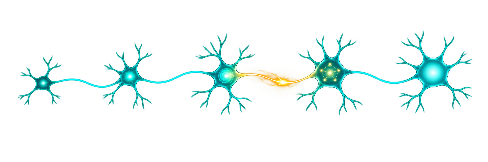
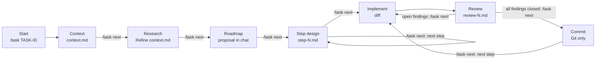

# Task workflow



`/task` guides a coding task through context collection, code research, roadmap approval, step design, implementation, and review. It keeps compact task artifacts in the project and starts separate Pi processes for implementation and review. The parent session shows the diff and review findings before accepting the step.

## 🔄 Workflow



`/task next` advances only when the current discussion has no open questions or unapproved proposals. `/task accept` approves a concrete pending proposal and then performs the same transition, provided no questions remain. With no proposal, `/task accept` leaves the phase unchanged. A short clarification can be included, for example `/task accept "I prefer option B"`. The diagram shows `/task next` after the discussion is settled; `/task accept` follows the same edge when a proposal needs approval.

## 🚀 Usage

From the project directory, identify the task:

```text
/task list
/task TASK-100500
```

`/task list` opens a selector for tasks in the current project. Each option shows the ID, phase and step progress, review status when relevant, and a short description from `context.md`. Choose a task to continue it; `Esc` cancels without changing the session. If another task is already attached, the selected task opens in a new session so their conversations stay separate. Outside the terminal UI, the command prints the list instead. The list does not enter the model context. Existing IDs also appear in `/task` argument completion with their current state.

If the task does not exist, Pi asks whether to create it and open a new session. If it already exists, `/task TASK-ID` asks whether to continue it. It attaches to the current session when no other task is attached; otherwise it opens a new session. Declining either prompt leaves the session and task files untouched. Once a new task starts, describe the problem or task and share the context you have; you can include ticket text if useful. Add more details as they come to mind. Pi maintains a compact `context.md` during this phase.

### Task ID parsing

The ID is the first argument after `/task`. An unquoted ID ends at the first space. Single or double quotes let an ID contain spaces; the quotes are removed before the ID is stored.

| Input | Parsed task ID |
| --- | --- |
| `/task TASK-100500` | `TASK-100500` |
| `/task "TASK 100500"` or `/task 'TASK 100500'` | `TASK 100500` |
| `/task TASK 100500` | Invalid: two separate arguments. |

IDs may contain ASCII letters, digits, dots, underscores, hyphens, and internal spaces. They must start with a letter or digit and cannot have leading or trailing spaces. Slashes, path separators, and quote characters are not allowed. The unquoted words `help`, `list`, `status`, `log`, `abort`, `next`, `accept`, `show`, `start`, and `continue` are reserved; quote one if you intend it as an ID, for example `/task "help"`. Unquoted `start` and `continue` show a migration hint.

The ID is required and becomes the task's directory name through the `artifactDir` template. `/task` without an ID does not create or attach a task. Add `--dir PATH` after the ID to select an artifact directory for this invocation; quote a path containing spaces. Pi records the location of tasks started or continued with `--dir`, so `/task list` and `/task TASK-ID` can find them later.

### Phases

Use `/task next` after the discussion is settled. Use `/task accept` when you want to approve Pi's pending proposal. The phases run in this order:

| Phase | Purpose and discussion | Artifact updates | What `/task next` does |
| --- | --- | --- | --- |
| **Context** | Describe the problem, requirements, and possible approaches. Add details over several messages. | Pi updates `context.md` after each input with compact task context. | Starts code research. |
| **Research** | Inspect the project, check feasibility, and discuss findings and open questions. Agree which code locations and decisions matter. | Pi updates `context.md` as confirmed facts and decisions emerge. Unresolved doubts stay out. | Consolidates `context.md`, then asks Pi to propose a roadmap. |
| **Roadmap** | Discuss the numbered plan and resolve questions or additions. If agreed task context changes, Pi updates `context.md` and presents a complete revised roadmap in chat. | Pi may maintain `roadmap.md` as a draft during discussion. | Confirms the approved plan in `roadmap.md`, then starts step 1 design. |
| **Step design** | Discuss each roadmap step in detail, one at a time. New requirements or plan items can be agreed here. | Pi can update `context.md`, `roadmap.md`, or any `step-N.md` as needed. For example, adding a roadmap item during step 1 updates `roadmap.md` before advancing. | Confirms the current `step-N.md` and starts the next discussion. After the last design, implementation becomes available. |
| **Implementation** | A separate Pi implements one approved step. | The worker changes project code. The parent saves `implementation-N.diff` after the run. | Starts the worker. When it finishes, review begins automatically. |
| **Review** | A separate Pi inspects the implementation with read-only tools. Discuss each finding and its status. Each finding includes a short exact excerpt from the diff. | The parent creates `review-N.md`. During discussion Pi updates findings as `open`, `resolved`, or `dismissed`, preserving excerpts. Earlier review rounds are archived as `review-N-round-M.md`. | With open findings, starts a separate write-capable repair process and then repeats read-only review. When all findings are resolved or dismissed, accepts the step and proposes or creates a commit in Git projects. Without Git, it skips the commit. Another `/task next` starts the next step. |

The phase describes what you are discussing, not which task artifacts Pi may edit. Any phase may update `context.md`, `roadmap.md`, `step-N.md`, or `review-N.md` when an agreed change calls for it. A successful transition confirms the artifact for that phase. The extension updates `state.json` when a phase or step changes. Only the implementation worker edits project code.

`resolved` means the code was checked after a fix; `dismissed` records an agreed reason for rejecting a finding. Missing status in an older review file is treated as `open`. A successful transition with open findings starts a repair worker; it cannot accept the step until another review clears them.

Pi only recognizes a slash command at the start of an input. `I agree. /task next` is ordinary text and will not advance. Use `/task accept` to combine approval and transition in one input. Its optional note can select or qualify the proposal. Free-form wording such as “advance if there are no questions” remains a discussion message and does not change the phase.

Before either command changes the phase or starts a worker, the active Pi model checks the recent discussion. An unanswered material question blocks both commands. An unapproved proposal blocks `/task next`; the absence of a proposal blocks `/task accept`. If the check fails or cannot produce a valid answer, the phase stays unchanged. This check is a model judgment over the conversation, so keep important decisions explicit; the extension cannot prove from free-form chat that every question has been resolved.

### What each Pi sees

The main Pi keeps the task's conversation in its normal session context, subject to Pi's usual context compaction. The extension adds instructions for the current phase. Task artifacts are files on disk: the main Pi reads them when the phase instructions call for them, rather than having every artifact inserted into every prompt.

| Phase or action | Context available to the model |
| --- | --- |
| **Context, research, roadmap, and step design** | The main Pi's conversation, including your answers and earlier decisions, plus phase-specific instructions. It can read project files and task artifacts. In the context phase it reads and updates `context.md` after your input; later phases read and update the relevant artifacts as discussion requires. |
| **Implementation** | A fresh Pi process receives the full contents of `context.md`, `roadmap.md`, and every `step-N.md`. Steps are marked completed, current, or planned. It can inspect the current project files and receives the approved proposal when `/task accept` starts the run. It does not receive the main conversation history. |
| **Review worker** | Another fresh Pi process receives paths to `context.md`, `roadmap.md`, the current `step-N.md`, and `implementation-N.diff`; it reads those files and relevant code. On repeated review it also reads the previous `review-N.md`. It may load the configured review skill. It does not receive the main conversation or the implementation worker's conversation. |
| **Review discussion** | Back in the main Pi session, the implementation summary and diff and the review result appear as messages. The main Pi can read `review-N.md`, the diff, and project files while discussing findings with you. |
| **Repair** | A new implementation process receives the same task artifacts as the initial implementation, plus the current `review-N.md` and any approval passed through `/task accept`. It inspects the current code, addresses open findings, and then a fresh review worker runs again. |

Implementation and review workers use `--no-session`, so their own conversations are not saved as Pi sessions. Their durable handoff is the task artifacts and current project files. Each process still starts with Pi's normal system prompt and discovers applicable project instructions; the review worker's tools are restricted to reading. The `/task next` and `/task accept` readiness check is a separate model call with a limited view: up to 16 recent messages from the current phase, the current review artifact when present, and the command note. It does not read the whole session or project code.

Other commands:

| Command | Purpose |
| --- | --- |
| `/task help` | Show a summary of commands without adding it to the session. |
| `/task list` | Select a current-project task to continue; outside the terminal UI, show the list. |
| `/task status` | Show the phase, paths, worker activity, Git availability, step status, commit mode, and `/tree` setting without adding it to the session. |
| `/task log` | Reopen the live implementation, repair, or review progress window. |
| `/task abort` | Stop the running worker; the task remains available for a later retry. |
| `/task TASK-100500` | Start or continue the task after confirmation. |
| `/task show roadmap` | Open an artifact in a scrollable overlay without adding it to the session. |

`/task show` accepts `context`, `research`, `roadmap`, `step-N`, `implementation-N`, and `review-N`. Its arguments are available through command completion. Use `j` and `k` or the arrow keys to scroll, and `Enter` or `Esc` to close the overlay.

## 🗂️ Artifacts and configuration

By default, all task files live under `<project>/.agents/projects/<task-id>/`:

| File | Purpose |
| --- | --- |
| `context.md` | Compact task context and agreed research findings. |
| `roadmap.md` | Approved numbered roadmap. |
| `step-N.md` | Approved design for step N. |
| `implementation-N.diff` | Diff produced by implementation step N. |
| `review-N.md` | Review summary, findings, diff excerpts, and discussion state for step N. |
| `state.json` | Phase, paths, and completed step status. |

To place all artifacts elsewhere, use `/task TASK-100500 --dir PATH`, or set `artifactDir` in `~/.pi/agent/task-workflow.json`. Use the same directory with `/task TASK-100500 --dir PATH` if you later change the config. The config file also controls automatic commits, the implementation model, and `/tree` navigation:

```json
{
  "artifactDir": "{projectRoot}/.agents/projects/{taskId}",
  "autoCommit": false,
  "implementModel": null,
  "reviewSkill": "task-review",
  "allowTreeNavigation": false,
  "snapshotMaxFiles": 4000,
  "snapshotMaxMiB": 100
}
```

`autoCommit` defaults to `false`, so accepting a review in a Git repository produces an English commit title and detailed body for you to use. When set to `true`, the extension commits the step's code changes with that message. Automatic commits require a clean code working tree before the implementation run and verify that the reviewed files have not changed before committing. In a project without Git, accepting a review completes the step without drafting or creating a commit, regardless of `autoCommit`. The implementation agent itself does not commit.

With `implementModel: null` (or with the setting omitted), the implementation agent inherits the active Pi model and thinking level. To override them for every implementation step, set:

```json
{
  "artifactDir": "{projectRoot}/.agents/projects/{taskId}",
  "autoCommit": false,
  "allowTreeNavigation": false,
  "implementModel": {
    "provider": "openrouter",
    "model": "openai/gpt-6-luna",
    "thinkingLevel": "medium"
  }
}
```

`provider` and `model` are required in the override. `thinkingLevel` is optional; when omitted, it inherits the active Pi thinking level. The commit-message draft still uses the parent session's active model.

`reviewSkill` is a discovered Pi skill name, not a path to `SKILL.md`. It defaults to `"task-review"`; set another name to use a different skill, or `null` to disable skill instructions. If the named skill is unavailable, review continues without it. The review worker reads the selected skill only where its instructions fit read-only review.

`snapshotMaxFiles` and `snapshotMaxMiB` limit the baseline copied before an implementation worker starts. Their defaults are 4,000 files and 100 MiB. The extension checks both limits before copying anything; if either is exceeded, it reports the limit and leaves the worker stopped. Raise the values in this config only if the project needs a larger snapshot. These limits apply to the initial baseline, including retries that create a new baseline.

The directory template accepts `{projectRoot}` and `{taskId}`. A relative path is resolved from the project root. `context.md`, `roadmap.md`, `step-N.md`, `implementation-N.diff`, `review-N.md`, and `state.json` are all stored in the selected directory. Task discovery scans the default location, the current `artifactDir` template when `{taskId}` is a whole path component, and a small index under `~/.pi/agent/task-workflow-index/`. Existing tasks created earlier with a one-off `--dir` become discoverable after you open one once using its ID and explicit directory.

## 🔧 Implementation notes

The main Pi session stores a link to the task's `state.json`. The extension uses that file to track the current phase, approved steps, and pending transitions. `/task next` starts the work for the next phase; an artifact acceptance advances only after the requested file has actually been saved. The separate Pi process used for `implement` receives the approved artifacts and runs with its own context. Its diff is captured by the parent. A second Pi process reviews that diff and relevant code. Review findings are saved before the user accepts the step. Open findings start a new implementation process with the review discussion; acceptance waits for a subsequent review with no open findings.

The model writes task artifacts through `task_write_artifact`. This tool takes a complete replacement document and an artifact kind (`context`, `roadmap`, `step`, or `review`); the extension chooses the filename and writes it atomically. A `step` number can target a specific `step-N.md` or `review-N.md`; omitting it targets the current step. There is no phase-based write restriction on these artifacts. The model should update them only when the conversation establishes an agreed change. Code references require prior discussion with the user, and unresolved doubts stay out of the context artifact. A context change in roadmap also calls for a revised roadmap proposal in the same answer. `/task next` confirms the current transition by writing its target artifact; writing a different artifact does not count as accepting it. Review updates must keep exact diff excerpts beside findings and require the corresponding implementation diff. The extension itself writes `state.json`, implementation diff files, and the initial review artifact.

### Safety mechanisms

- In a task session, the main Pi exposes only `read`, `grep`, `find`, `ls`, and `task_write_artifact` to the model. The `tool_call` hook also blocks every other tool before execution, including `write`, `edit`, `bash`, and tools added by other extensions. This second check still applies if the visible tool list changes.
- `task_write_artifact` does not accept a path. It maps the artifact kind and optional step number to a file in `artifactDir`, writes atomically, and refuses to replace a symbolic link. Phase does not limit which task artifact can be updated. The acceptance flag advances only when the artifact for the pending transition is saved. If task state cannot be read, the tool guard blocks all tool calls.
- The implementation worker is a separate Pi process launched with `--no-extensions`. The main session's tool restrictions do not apply to that worker, so it can edit project files during `implement`.
- The review worker is another Pi process launched with `--no-extensions`, `--no-mcp`, and `--tools read,grep,find,ls`. It cannot call write, edit, or shell tools. Pi discovers skills normally; the worker loads the configured `reviewSkill` if available and compatible with read-only review. No review skill is required. The parent validates that every finding has an exact excerpt from `implementation-N.diff`, then writes `review-N.md` and shows the same findings in the session. If review fails, the task remains in the review phase and `/task next` retries it. A repair worker uses the implementation model and receives the reviewed findings and discussion. It can edit project code; the review worker runs again afterward.

These are controls over model tool calls, not operating-system file permissions. A user-run terminal command or another extension's own code can still write files with the account's permissions. The extension does not try to sandbox those actions.

### Tree navigation

Pi's `/tree` changes the active conversation branch, but it does not restore `state.json`, task artifacts, or project code to the selected point. All branches would share the latest task files. Returning to an earlier discussion could therefore combine old chat context with newer task state and overwrite later decisions. Navigating to a point before the task link was attached could also remove the extension's tool guard from that branch.

The extension blocks `/tree` while a task is attached to the active branch. It cancels navigation before Pi switches branches and shows a warning. This is the default even if `allowTreeNavigation` is omitted from the config. Set `"allowTreeNavigation": true` in `~/.pi/agent/task-workflow.json` to allow `/tree`; this removes only the block, not the shared-state risks. `/task status` shows the current setting. The option applies to `/tree` navigation, not to `/fork` or `/clone`.

### Implementation diff

While an implementation, repair, or review worker runs in the terminal UI, a progress panel shows recent tool calls, short tool-output excerpts, elapsed time, and time since the last event. Implementation and repair also show streamed assistant text. Use `j` and `k` to scroll. `Enter` or `Esc` closes only the log window; the worker continues, and the status line stays visible. Use `/task log` in the main session to reopen the window, `/task status` for a summary, and `/task abort` to stop the worker. Other keys in the log window do not interrupt it. The task does not accept another transition while a worker is running. A cancelled or failed implementation saves its partial diff as `implementation-N-failed.diff` and leaves the step unaccepted. The original baseline is retained so a retry can include partial changes in the step's diff. A cancelled review remains pending and can be retried with `/task next`. Workers also have a 30-minute timeout; cancellation and timeout stop the process group before the parent continues. Leaving or reloading the Pi session also stops its worker so it cannot continue without a controllable parent session.

Before the worker starts, the parent prepares a file baseline; afterward, it compares files to produce the diff. These stages show progress in the terminal instead of blocking its event loop. In a project without Git, the parent must scan and snapshot regular files, which can still take time in large directories. It records hashes in the baseline and runs `git diff --no-index` only for files whose contents changed.

In a Git repository, the parent snapshots any existing code changes into a private directory inside the task artifacts before starting the implementation worker. It retains this baseline through repair and review rounds, then deletes it when the step is accepted. After each worker run, it uses Git to list currently changed tracked files and untracked, non-ignored files, excluding the task artifacts. For files present in the snapshot, it compares the snapshot with the current file using `git diff --no-index --binary`. For tracked files that were clean at the start, it uses `git diff --binary HEAD`; for newly created files, it compares against `/dev/null`.

Without a Git repository, the directory where the task was started acts as the project root. The parent snapshots all regular files beneath it before implementation, excluding the task artifact directory, `.git` directories, and symbolic links. It keeps the baseline through review and repair rounds and compares the before and after file lists and contents using `git diff --no-ext-diff --no-index --binary`, which works outside a repository but still requires the Git executable. Disabling external diff tools keeps the artifact in standard patch format. This detects created, modified, and deleted regular files. Copying every project file can take longer and use more storage than the Git-based path; symbolic link changes are not included.

Before copying, the extension checks the snapshot against `snapshotMaxFiles` and `snapshotMaxMiB`. In a Git repository, this covers existing changed files that need a baseline. Without Git, it covers all regular project files described above. The worker does not start when either limit is exceeded.

After a successful run, the combined result is saved as `implementation-N.diff`. The session shows up to 60,000 characters of that diff; the artifact contains the full result.

The Git-based method has a limitation: the final file list comes from Git after the worker runs. If the worker removes an untracked file that existed before it started, or restores a previously modified tracked file exactly to `HEAD`, that file may disappear from the list and its change will not appear in the diff.
